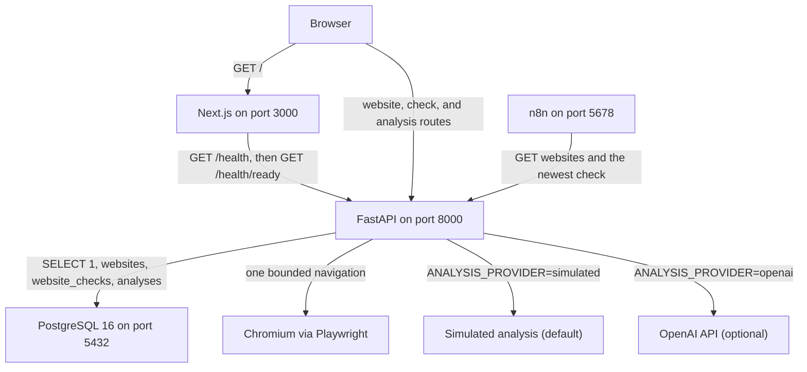

# Sentinel

Sentinel is an AI-powered website testing and monitoring platform. The product opens a site in a browser, records what failed, and can use AI to explain the failure. Notifications and follow-up workflows go through n8n.

Milestone 1 is the development foundation. Milestone 2 adds a website registry. Milestone 3 opens a registered site in Chromium, stores the result, and shows it on the registry page. n8n can read those stored results and draft a follow-up message. On-demand AI failure analysis can interpret a stored failed check. Opt-in scheduled monitoring can run enrolled sites on an n8n timer. Failed-check drafts can be delivered to an optional free webhook when configured in n8n. Email/password accounts and a basic dashboard protect the registry while n8n keeps working via automation tokens. The product still does not require paid email or auto-analyze every failure.

## Current status

The running system is a FastAPI process, a Next.js app, and PostgreSQL in Docker Compose. One shared list of websites is stored in Postgres. There is no authentication and no tenant separation.

| Piece | What it does today |
| --- | --- |
| `GET /health` | Reports that the API process can answer HTTP. It does not touch the database. |
| `GET /health/ready` | Runs `SELECT 1`. Returns `200` when PostgreSQL answers and `503` when it does not. |
| `POST /api/websites` | Stores a name and an HTTP or HTTPS base URL. `monitoring_enabled` starts as `false`. Returns `201`, or `409` when that URL is already registered. |
| `POST /api/auth/register`, `POST /api/auth/login`, `POST /api/auth/logout`, `GET /api/auth/me` | Email/password accounts and HttpOnly session cookies. |
| `GET /api/dashboard` | Sites, windowed recent checks (`stats_window` / `history_window`), per-site uptime/latency, and a `health` roll-up. Requires sign-in or automation token. |
| `GET /api/websites/{id}/checks` | Capped check history (`window=24h\|7d\|all`, `limit≤50`). Default window `all` for n8n newest-N. |
| `GET /api/websites/{id}/stats` | Capped uptime %, avg/p95 duration, and recent points (`window=24h\|7d\|all`). |
| `GET /api/websites/{id}/monitoring-state` | `still_failing` / `recovered` plus AUTO-2 `should_notify_*` intents (for n8n branching). |
| `PATCH /api/websites/{id}` | Enrollment, optional thresholds, and AUTO-2 `notify_on_fail` / `notify_on_recover` / `notify_on_latency`. |
| `GET /api/websites` | Lists websites visible to the caller, newest first. Optional `?monitoring=true` (or `false`) filters enrollment. Requires session or `X-Automation-Token`. |
| `GET /api/websites/{website_id}` | Returns one website, or `404`. |
| `PATCH /api/websites/{website_id}` | Sets `monitoring_enabled` for opt-in scheduled checks. |
| `DELETE /api/websites/{website_id}` | Deletes one website and its check history. Returns `204`, or `404`. |
| `POST /api/websites/{website_id}/checks` | Opens that site in Chromium after the caller sets `authorized` to `true`. Stores the result and returns `201`. A non-public address returns `422` and does not start the browser. |
| `POST /api/websites/{website_id}/scheduled-checks` | Same check path for automation. Requires `X-Schedule-Check-Token` and `monitoring_enabled=true`. Returns `401`/`422`/`503` when the token or enrollment is wrong. |
| `GET /api/websites/{website_id}/checks` | Returns that site's recent checks, newest first. The default is 20 and the maximum is 50. |
| `GET /api/checks/{check_id}` | Returns one stored check (`has_screenshot` when a PNG was kept), or `404`. |
| `GET /api/checks/{check_id}/screenshot` | Returns the stored viewport PNG, or `404`. |
| `POST/GET /api/websites/{id}/journeys` | Create/list declarative mini-journeys (BROW-2; separate from one-shot checks). |
| `POST /api/journeys/{id}/runs` | Run a journey after `authorized: true`. |
| `POST /api/checks/{check_id}/analysis` | Analyzes one stored failed check. Default provider is **simulated** (local heuristics, no AI network calls). Optional `ANALYSIS_PROVIDER=openai` uses the OpenAI API when a key is set. Returns `201` on first create, `200` when an analysis already exists (no second provider run), `422` for a successful check, `404` when the check is missing, `503` when openai mode lacks a key, or `502` when the provider fails. Does not start a browser check. Response includes `provider` (`simulated` or `openai`). |
| `GET /api/checks/{check_id}/analysis` | Returns the stored analysis, or `404`. Never calls the provider. |
| Next.js page at `/` | The server calls the two health routes and renders the result. |
| Next.js pages at `/login`, `/register`, `/dashboard`, `/websites`, `/websites/[id]`, `/checks/[id]` | Sign in, health overview, per-site trends drill-down, check detail (analysis + screenshot stub), and registry. Run check asks for an authorization acknowledgement. |
| Pytest | Locks the health contract, the website registry, the address policy, check persistence, failure analysis, scheduled monitoring enrollment/token rules, and the shape of the n8n workflow files. Check and analysis tests use fakes and do not visit public websites or call OpenAI. Workflow tests do not start n8n. The one connectivity test skips when PostgreSQL is unreachable. A skip is not a passing check. |
| GitHub Actions | Free CI on push/PR (`.github/workflows/ci.yml`): backend pytest against Postgres 16, plus frontend typecheck and build. Disposable CI env only; secrets are not echoed. See [CI](docs/learning/ci.md). |

## Architecture

The browser talks to Next.js. For the status page, the Next.js server calls FastAPI while it builds the HTML. For the registry, the browser calls FastAPI directly. FastAPI talks to PostgreSQL for readiness and for website rows. Docker runs the database. The API and the website run on the host so reload stays ordinary.



On this machine, PostgreSQL runs in Docker Engine inside Ubuntu on WSL 2. Windows reaches it at `localhost:5432` through `wslrelay`.

## Technology stack

In use now:

- Python and FastAPI for the API
- Async SQLAlchemy and asyncpg for PostgreSQL
- Alembic for the `websites` and `website_checks` migrations
- PostgreSQL 16, started by Docker Compose
- Next.js, React, and TypeScript for the status page and the website registry
- Playwright's Python async API, and the Chromium build it downloads, for one website check
- A simulated failure-analysis provider (default in development) plus the official OpenAI Python SDK as an optional path
- n8n 2.46.7, started by Docker Compose, for a manual follow-up over stored checks
- Pytest for the API contract

Planned, and not implemented in this repository:

- Paid SMTP/email as a required path (optional free webhook delivery is enough for demos)
- Multi-tenant isolation, OAuth, or billing beyond simple per-user ownership
- Autonomous agents, tool calling, or scheduled AI analysis runs
- PHP and Laravel in a later milestone, where a second backend fits the architecture
- Container images for the API and the website, if a later milestone needs them

There is no Redis and no task queue. A check runs inside the API request and stops when its timeout expires. Analysis also runs inside the request that asked for it. n8n reads stored checks, can run enrolled scheduled checks, and can optionally POST a failure draft to a webhook. The Sentinel tables are `websites`, `website_checks`, and `check_failure_analyses`. Deleting a website deletes its checks and any analyses. n8n keeps a separate SQLite file for its editor.

## Local development

Prerequisites used for this milestone:

- Python 3.11 or newer on Windows. This checkout was tested with Python 3.14.
- Node.js 22 on Windows.
- Docker Engine with Compose v2, inside Ubuntu on WSL 2. `docker` is not a PowerShell command in this setup.

From the repository root in PowerShell, copy the example environment file before you change any local value:

```powershell
Copy-Item .env.example .env
```

`.env.example` contains local placeholders, including the database password `sentinel`. That password is for a database that listens only on your machine. `.env` is gitignored. The copy is optional while you still use those defaults.

Start PostgreSQL from Ubuntu, in this repository. A Windows path such as `C:\Users\<you>\Desktop\Sentinel` is `/mnt/c/Users/<you>/Desktop/Sentinel` in WSL. The Ubuntu user must be in the `docker` group.

```bash
docker compose up -d
```

Backend, from `backend`:

```powershell
py -3.14 -m venv .venv
.\.venv\Scripts\python.exe -m pip install -e ".[dev]"
.\.venv\Scripts\python.exe -m alembic upgrade head
.\.venv\Scripts\python.exe -m uvicorn app.main:app --reload --host 127.0.0.1 --port 8000
```

`alembic upgrade head` creates the `websites`, `website_checks`, and `check_failure_analyses` tables. The API does not migrate itself on startup. Repeat the upgrade after a new revision is added.

Chromium is separate from the Python package. Install it once in the same virtual environment before you run a check by hand:

```powershell
.\.venv\Scripts\python.exe -m playwright install chromium
```

The automated tests do not download or launch Chromium. They use a fake runner.

Frontend, from `frontend`:

```powershell
npm install
npm run dev
```

Open [http://127.0.0.1:3000](http://127.0.0.1:3000) for status and [http://127.0.0.1:3000/websites](http://127.0.0.1:3000/websites) for the registry. Interactive API docs are at [http://127.0.0.1:8000/docs](http://127.0.0.1:8000/docs). The registry page calls the API from the browser, so `CORS_ORIGINS` must include the origin you actually open. `http://localhost:3000` and `http://127.0.0.1:3000` are different origins.

### Checks

From `backend`:

```powershell
.\.venv\Scripts\python.exe -m pytest -v
```

From `frontend`:

```powershell
npm run typecheck
```

`npm run typecheck` checks types. It does not start the website or call the API.

### Configuration

| Variable | Consumer | Purpose |
| --- | --- | --- |
| `POSTGRES_USER`, `POSTGRES_PASSWORD`, `POSTGRES_DB`, `POSTGRES_PORT` | Docker Compose | Database account and published host port |
| `DATABASE_URL` | API | SQLAlchemy URL. It must start with `postgresql+asyncpg://` and match the `POSTGRES_*` values |
| `ENVIRONMENT` | API | Returned by the health endpoints. Default `development` |
| `CORS_ORIGINS` | API | Comma-separated browser origins allowed to call the API. The default lists both localhost and 127.0.0.1 on port 3000 |
| `CHECK_NAVIGATION_TIMEOUT_SECONDS` | API | How long one navigation may take, from 1 to 60. The default is 15. The runner then allows 10 more seconds for Chromium to start |
| `ANALYSIS_PROVIDER` | API | `simulated` (default, local heuristics, no AI network) or `openai` |
| `OPENAI_API_KEY` | API | Required only when `ANALYSIS_PROVIDER=openai`. Empty is fine for simulated mode |
| `OPENAI_MODEL` | API | Model id for OpenAI mode. Default `gpt-4o-mini` |
| `OPENAI_TIMEOUT_SECONDS` | API | OpenAI timeout in seconds, from 1 to 120. Default `30` |
| `OPENAI_MAX_OUTPUT_TOKENS` | API | Max completion tokens for one OpenAI analysis, from 100 to 4000. Default `1200` |
| `N8N_PORT` | Docker Compose | Host port for the n8n editor. Default `5678` |
| `SENTINEL_API_URL` | Documentation only | Same value as the n8n **API address** node (`http://host.docker.internal:8000`). n8n does not load this variable |
| `SCHEDULE_CHECK_TOKEN` | API | Shared secret for `X-Schedule-Check-Token` on scheduled checks. Must match the workflow `scheduleToken`. Empty refuses scheduled POSTs |
| `FAILURE_DRAFT_WEBHOOK_URL` | Documentation only | Same value to paste into the n8n `webhookUrl` field. n8n does not load this variable; empty means drafts stay local |
| `NEXT_PUBLIC_API_URL` | Next.js | API address used by the status page and the registry. Set this in `frontend/.env.local`, not in the root `.env` |

Compose does not build `DATABASE_URL`. If the password in one place changes, change the other. Next.js does not read the root `.env`. When `NEXT_PUBLIC_API_URL` is absent, the page uses `http://localhost:8000`.

n8n is included in `docker compose up -d`. Optional **Mailpit** starts with `--profile mail`. Optional **API + web containers** start with `--profile app` (ENG-4) — see [docker demo](docs/learning/docker-demo.md) and [free email path](docs/learning/free-email-path.md). Import and run steps are in [n8n follow-up](docs/learning/n8n-follow-up.md), [scheduled monitoring](docs/learning/scheduled-monitoring.md), and [failure draft delivery](docs/learning/failure-draft-delivery.md). Workflows draft failures and optionally POST the draft JSON to a free webhook when `webhookUrl` is set.

### Run a check

Register a site you are allowed to test, then open `http://127.0.0.1:3000/websites`. Choose Run check, confirm that you are authorized, and wait. The page shows the HTTP status, title, duration, and outcome. Console errors and failed requests appear when the check recorded any. Check history loads the stored rows for that site.

From PowerShell, the same call is:

```powershell
Invoke-RestMethod http://127.0.0.1:8000/api/websites/<website-id>/checks -Method Post -ContentType "application/json" -Body '{"authorized":true}'
```

A check of `localhost`, a private address, or a cloud metadata address returns `422` and does not start Chromium. The acknowledgement is a confirmation, not proof that you own the site. There is still no login.

### Analyze a failed check

After a failed check appears on `/websites`, choose **Analyze failure**. That call uses the stored row only. With the default `ANALYSIS_PROVIDER=simulated`, no OpenAI key is needed and the UI labels the result as simulated. To use a live model later, set `ANALYSIS_PROVIDER=openai` and `OPENAI_API_KEY`, then restart the API. A second analyze for the same check returns the saved result and does not run the provider again. Details are in [AI failure analysis](docs/learning/ai-failure-analysis.md).

Limits that this prototype does not fully close:

- Chromium resolves and connects on its own after Sentinel's lookup. A DNS change in that gap can still point at an internal address.
- The check remembers the first decision for each host, so a later change of that host's addresses is not seen until the next check.
- Some browser requests, including WebSockets, may not pass through the page route that blocks private addresses.
- Console text is truncated and filtered for common secret shapes. A page can still print a secret in another shape.
- Stored URLs drop userinfo, query strings, and fragments. A query that is part of the page address is not kept.
- One check occupies the API request until it finishes or the timeout fires. There is no queue and no schedule.

## Documentation

- [Architecture overview](docs/architecture/overview.md) covers the layout, request flow, and design decisions.
- [Development environment](docs/learning/development-environment.md) is the machine-level setup and troubleshooting order.
- [Technical walkthrough](docs/learning/milestone-1-technical-walkthrough.md) explains the code that is in the repository today, including the website registry and browser checks.
- [n8n follow-up](docs/learning/n8n-follow-up.md) explains the workflow, why it only reads stored checks, and how to run it.
- [AI failure analysis](docs/learning/ai-failure-analysis.md) explains on-demand analysis of a stored failed check.
- [Scheduled monitoring](docs/learning/scheduled-monitoring.md) explains opt-in n8n timers, enrollment, and the schedule token.
- [Accounts and dashboard](docs/learning/accounts-and-dashboard.md) explains email/password sessions, ownership, and automation tokens.
- [Dashboard health UI](docs/learning/dashboard-health-ui.md) explains DASH-2 overview, site drill-down, and check detail.
- [Monitoring configuration](docs/learning/monitoring-config.md) explains DASH-3 enrollment + thresholds + notification rules UI.
- [Check screenshots](docs/learning/check-screenshots.md) explains BROW-1 bounded viewport PNGs on check detail.
- [Browser journeys](docs/learning/browser-journeys.md) explains BROW-2 declarative navigate/fill/click/assert flows.
- [Uptime and latency](docs/learning/uptime-and-latency.md) explains MON-1 check aggregates.
- [Thresholds and recovery](docs/learning/thresholds-and-recovery.md) explains MON-2 monitoring-state flags.
- [Notification rules](docs/learning/notification-rules.md) explains AUTO-2 per-site notify toggles and n8n intents.
- [Roadmap](docs/roadmap.md) lists the finite advanced milestones.
- [Failure draft delivery](docs/learning/failure-draft-delivery.md) explains optional webhook delivery of failed-check drafts.
- [Free email path](docs/learning/free-email-path.md) explains optional Mailpit (AUTO-3) without a paid ESP.
- [CI](docs/learning/ci.md) explains the GitHub Actions workflow (ENG-1).
- [API stability](docs/learning/api-stability.md) explains ENG-2 path-stability rules (no premature `/api/v1`).
- [Docker demo](docs/learning/docker-demo.md) explains ENG-4 Compose profile `app`.
- [Public shell deploy](docs/learning/public-shell-deploy.md) explains the $0 Render+Neon prep (no live Chromium on Free).
