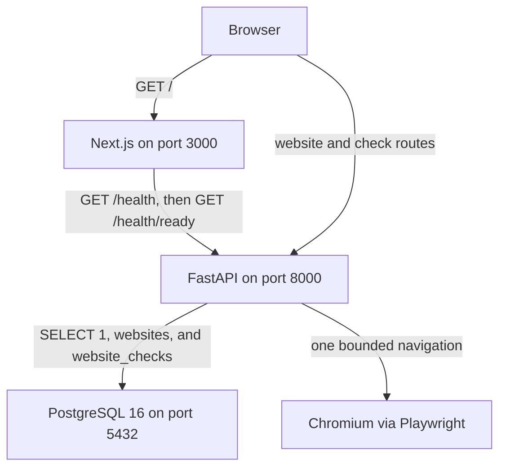

# Sentinel

Sentinel is an AI-powered website testing and monitoring platform. The product will open a site in a browser, record what failed, and use AI to explain the failure. Notifications and follow-up workflows will go through n8n.

Milestone 1 is the development foundation. Milestone 2 adds a website registry. Milestone 3 opens a registered site in Chromium, stores the result, and shows it on the registry page. The product still does not call an AI service, schedule checks, or provide accounts.

## Current status

The running system is a FastAPI process, a Next.js app, and PostgreSQL in Docker Compose. One shared list of websites is stored in Postgres. There is no authentication and no tenant separation.

| Piece | What it does today |
| --- | --- |
| `GET /health` | Reports that the API process can answer HTTP. It does not touch the database. |
| `GET /health/ready` | Runs `SELECT 1`. Returns `200` when PostgreSQL answers and `503` when it does not. |
| `POST /api/websites` | Stores a name and an HTTP or HTTPS base URL. Returns `201`, or `409` when that URL is already registered. |
| `GET /api/websites` | Lists the saved websites, newest first. |
| `GET /api/websites/{website_id}` | Returns one website, or `404`. |
| `DELETE /api/websites/{website_id}` | Deletes one website and its check history. Returns `204`, or `404`. |
| `POST /api/websites/{website_id}/checks` | Opens that site in Chromium after the caller sets `authorized` to `true`. Stores the result and returns `201`. A non-public address returns `422` and does not start the browser. |
| `GET /api/websites/{website_id}/checks` | Returns that site's recent checks, newest first. The default is 20 and the maximum is 50. |
| `GET /api/checks/{check_id}` | Returns one stored check, or `404`. |
| Next.js page at `/` | The server calls the two health routes and renders the result. |
| Next.js page at `/websites` | The browser loads, creates, and deletes websites. Run check asks for an authorization acknowledgement, then shows the outcome, HTTP status, title, duration, console errors, and failed requests. |
| Pytest | Locks the health contract, the website registry, the address policy, and check persistence. Check tests use a fake browser runner and do not visit public websites. The one connectivity test skips when PostgreSQL is unreachable. A skip is not a passing check. |

## Architecture

The browser talks to Next.js. For the status page, the Next.js server calls FastAPI while it builds the HTML. For the registry, the browser calls FastAPI directly. FastAPI talks to PostgreSQL for readiness and for website rows. Docker runs the database. The API and the website run on the host so reload stays ordinary.



On this machine, PostgreSQL runs in Docker Engine inside Ubuntu on WSL 2. Windows reaches it at `localhost:5432` through `wslrelay`.

## Technology stack

In use now:

- Python and FastAPI for the API
- Async SQLAlchemy and asyncpg for PostgreSQL
- Alembic for the `websites` and `website_checks` migrations
- PostgreSQL 16, started by Docker Compose
- Next.js, React, and TypeScript for the status page and the website registry
- Playwright's Python async API, and the Chromium build it downloads, for one website check
- Pytest for the API contract

Planned, and not implemented in this repository:

- The OpenAI API for failure analysis
- n8n for notifications and workflow automation
- A product dashboard, saved monitors, scheduled checks, and user accounts
- PHP and Laravel in a later milestone, where a second backend fits the architecture
- Container images for the API and the website, if a later milestone needs them

There is no Redis and no task queue. A check runs inside the API request and stops when its timeout expires. The tables today are `websites` and `website_checks`. Deleting a website deletes its checks.

## Local development

Prerequisites used for this milestone:

- Python 3.11 or newer on Windows. This checkout was tested with Python 3.14.
- Node.js 22 on Windows.
- Docker Engine with Compose v2, inside Ubuntu on WSL 2. `docker` is not a PowerShell command in this setup.

From the repository root in PowerShell, copy the example environment file before you change any local value:

```powershell
Copy-Item .env.example .env
```

`.env.example` contains local placeholders, including the database password `sentinel`. That password is for a database that listens only on your machine. `.env` is gitignored. The copy is optional while you still use those defaults.

Start PostgreSQL from Ubuntu, in this repository. A Windows path such as `C:\Users\<you>\Desktop\Sentinel` is `/mnt/c/Users/<you>/Desktop/Sentinel` in WSL. The Ubuntu user must be in the `docker` group.

```bash
docker compose up -d
```

Backend, from `backend`:

```powershell
py -3.14 -m venv .venv
.\.venv\Scripts\python.exe -m pip install -e ".[dev]"
.\.venv\Scripts\python.exe -m alembic upgrade head
.\.venv\Scripts\python.exe -m uvicorn app.main:app --reload --host 127.0.0.1 --port 8000
```

`alembic upgrade head` creates the `websites` and `website_checks` tables. The API does not migrate itself on startup. Repeat the upgrade after a new revision is added.

Chromium is separate from the Python package. Install it once in the same virtual environment before you run a check by hand:

```powershell
.\.venv\Scripts\python.exe -m playwright install chromium
```

The automated tests do not download or launch Chromium. They use a fake runner.

Frontend, from `frontend`:

```powershell
npm install
npm run dev
```

Open [http://127.0.0.1:3000](http://127.0.0.1:3000) for status and [http://127.0.0.1:3000/websites](http://127.0.0.1:3000/websites) for the registry. Interactive API docs are at [http://127.0.0.1:8000/docs](http://127.0.0.1:8000/docs). The registry page calls the API from the browser, so `CORS_ORIGINS` must include the origin you actually open. `http://localhost:3000` and `http://127.0.0.1:3000` are different origins.

### Checks

From `backend`:

```powershell
.\.venv\Scripts\python.exe -m pytest -v
```

From `frontend`:

```powershell
npm run typecheck
```

`npm run typecheck` checks types. It does not start the website or call the API.

### Configuration

| Variable | Consumer | Purpose |
| --- | --- | --- |
| `POSTGRES_USER`, `POSTGRES_PASSWORD`, `POSTGRES_DB`, `POSTGRES_PORT` | Docker Compose | Database account and published host port |
| `DATABASE_URL` | API | SQLAlchemy URL. It must start with `postgresql+asyncpg://` and match the `POSTGRES_*` values |
| `ENVIRONMENT` | API | Returned by the health endpoints. Default `development` |
| `CORS_ORIGINS` | API | Comma-separated browser origins allowed to call the API. The default lists both localhost and 127.0.0.1 on port 3000 |
| `CHECK_NAVIGATION_TIMEOUT_SECONDS` | API | How long one navigation may take, from 1 to 60. The default is 15. The runner then allows 10 more seconds for Chromium to start |
| `NEXT_PUBLIC_API_URL` | Next.js | API address used by the status page and the registry. Set this in `frontend/.env.local`, not in the root `.env` |

Compose does not build `DATABASE_URL`. If the password in one place changes, change the other. Next.js does not read the root `.env`. When `NEXT_PUBLIC_API_URL` is absent, the page uses `http://localhost:8000`.

### Run a check

Register a site you are allowed to test, then open `http://127.0.0.1:3000/websites`. Choose Run check, confirm that you are authorized, and wait. The page shows the HTTP status, title, duration, and outcome. Console errors and failed requests appear when the check recorded any. Check history loads the stored rows for that site.

From PowerShell, the same call is:

```powershell
Invoke-RestMethod http://127.0.0.1:8000/api/websites/<website-id>/checks -Method Post -ContentType "application/json" -Body '{"authorized":true}'
```

A check of `localhost`, a private address, or a cloud metadata address returns `422` and does not start Chromium. The acknowledgement is a confirmation, not proof that you own the site. There is still no login.

Limits that this prototype does not fully close:

- Chromium resolves and connects on its own after Sentinel's lookup. A DNS change in that gap can still point at an internal address.
- The check remembers the first decision for each host, so a later change of that host's addresses is not seen until the next check.
- Some browser requests, including WebSockets, may not pass through the page route that blocks private addresses.
- Console text is truncated and filtered for common secret shapes. A page can still print a secret in another shape.
- Stored URLs drop userinfo, query strings, and fragments. A query that is part of the page address is not kept.
- One check occupies the API request until it finishes or the timeout fires. There is no queue and no schedule.

## Documentation

- [Architecture overview](docs/architecture/overview.md) covers the layout, request flow, and design decisions.
- [Development environment](docs/learning/development-environment.md) is the machine-level setup and troubleshooting order.
- [Technical walkthrough](docs/learning/milestone-1-technical-walkthrough.md) explains the code that is in the repository today, including the website registry and browser checks.
