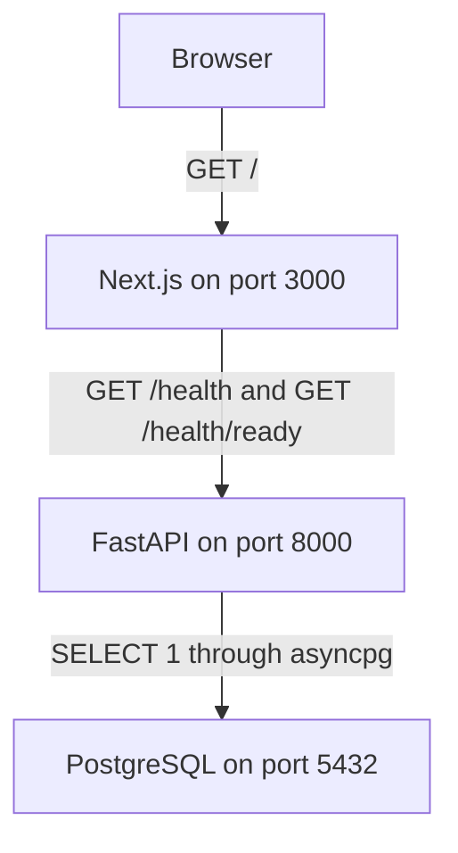
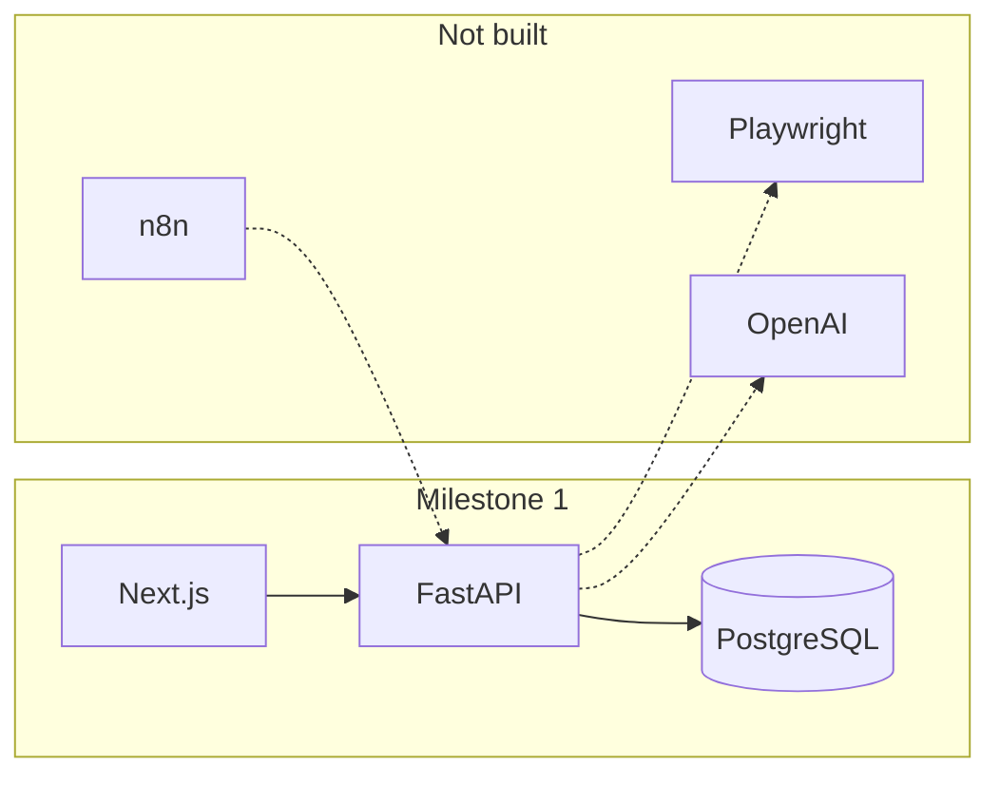
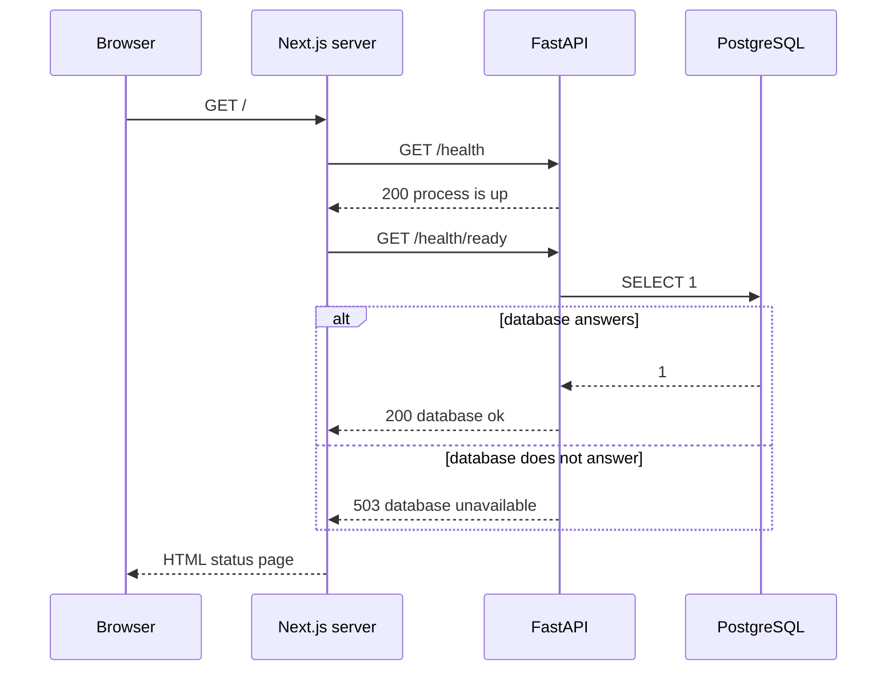
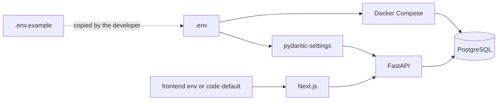

# Architecture overview

Sentinel is the start of a website testing and monitoring platform. A person will eventually describe a site to watch, the platform will open that site in a browser, and later steps will interpret the result and notify other tools.

This milestone does not do that work. It creates the place where that work will live, and it proves three things:

1. The API process can start and answer an HTTP request.
2. The API can open a PostgreSQL connection with SQLAlchemy.
3. The web app can render what the API reports.

Those three things are the foundation. Features built on top of them should not need a new repository layout.

## How to read the repository

Start here, then read [the development environment guide](../learning/development-environment.md). That guide is the click-by-click setup and a file-by-file walk through one page load. This document is the map and the reasoning.

## Layout

```text
Sentinel/
├── README.md
├── .env.example
├── .gitignore
├── docker-compose.yml
├── docs/
│   ├── architecture/overview.md
│   └── learning/development-environment.md
├── backend/
│   ├── pyproject.toml
│   ├── app/
│   │   ├── main.py
│   │   ├── api/routes/health.py
│   │   └── core/
│   │       ├── config.py
│   │       └── database.py
│   └── tests/
└── frontend/
    ├── package.json
    ├── package-lock.json
    ├── next.config.ts
    ├── tsconfig.json
    ├── next-env.d.ts
    ├── AGENTS.md
    ├── .env.example
    ├── app/
    │   ├── layout.tsx
    │   ├── page.tsx
    │   └── globals.css
    └── lib/api.ts
```

| Path | Purpose |
| --- | --- |
| `docker-compose.yml` | Starts PostgreSQL and nothing else. |
| `.env.example` | Documents the local database account and the API settings. Copy it to `.env` to override defaults. |
| `backend/app/main.py` | Builds the FastAPI application, CORS, logging, and the database lifecycle. |
| `backend/app/core/config.py` | Loads settings from the environment and the root `.env` file. |
| `backend/app/core/database.py` | Creates the async engine and session factory, and runs the connectivity query. |
| `backend/app/api/routes/health.py` | The only HTTP routes in this milestone. |
| `backend/tests/` | Automated checks for configuration and the health routes. |
| `frontend/app/page.tsx` | The only page. It shows the API's health report. |
| `frontend/lib/api.ts` | Server-side fetch of `/health` and `/health/ready`. |
| `docs/` | Explanations that should stay accurate as the code changes. |

`backend/.venv/` and `frontend/node_modules/` are created on your machine. They are not part of the design, and git ignores them.

## Runtime shape

The browser talks to Next.js. Next.js talks to FastAPI. FastAPI talks to PostgreSQL. Docker runs only the database. The API and the website run directly on the developer machine so code reload stays ordinary.



The next diagram is a boundary, not a running system. Dotted arrows are seams we are leaving open. No code on those arrows exists yet.



Playwright will drive a browser against a site under test. The OpenAI API will be used later to interpret results. n8n will sit outside this repository and call the API when a workflow needs Sentinel. None of those choices require Redis or a task queue yet, so neither is introduced. A queue is a later decision, made when a concrete job needs to leave the request process.

## Request flow

Refreshing the home page does not make the browser call FastAPI. The Next.js server calls FastAPI while it is building the HTML. That keeps the first page free of client-side fetching while there is only one screen.



`/health` is liveness. It answers "is this process able to speak HTTP?" A supervisor can use a failed liveness check as a signal to restart the process.

`/health/ready` is readiness. It answers "can this process do useful work right now?" Today the only dependency is PostgreSQL. A database outage makes the API unready. It does not mean the Python process is dead, so it must not be treated as a reason to restart the process in a loop.

There is no supervisor in this milestone. The split is still the contract, because adding the check later would change every caller.

## Configuration flow

One root `.env` file feeds two different consumers. Docker Compose reads `POSTGRES_*` for the database container. The API reads `DATABASE_URL`, `ENVIRONMENT`, and `CORS_ORIGINS`. Unknown names are ignored by the API, which is why both groups can share the file.



`DATABASE_URL` is not generated from `POSTGRES_*`. Both have to be edited together. The example file keeps them on adjacent lines for that reason. The `+asyncpg` suffix is required. It tells SQLAlchemy which driver to load. A URL that starts with `postgresql://` would select a synchronous driver and then fail inside the async engine, so settings reject it at startup.

Next.js does not read the root `.env`. Its optional override is `frontend/.env.local`, documented by `frontend/.env.example`. Until that file exists, `frontend/lib/api.ts` uses `http://localhost:8000`.

## Components

### Browser

The browser is the developer's window onto the status page. In this milestone it does not hold application state and it does not call the API. Later product screens may call the API from the browser. CORS is already limited to the configured frontend origin so that step does not require opening the API to every site.

### Next.js application

`frontend/app/layout.tsx` is the HTML document: language, title, and the shared stylesheet.

`frontend/app/page.tsx` is a server component. `export const dynamic = "force-dynamic"` tells Next.js to render it on each request. Without that, a production build could try to snapshot the page at build time and would fail, or go stale, when the API was down during the build.

`frontend/lib/api.ts` fetches both health routes with an eight-second timeout and `cache: "no-store"`. Health is not a cacheable document. The module also checks the JSON shape before the page reads it, so an unexpected payload becomes an error message instead of a crash on a missing field. Eight seconds is longer than the database connect timeout on purpose: the page needs the `503` body so it can say the database is unavailable. If the page gave up at the same moment as the driver, a down database would look like a dead API.

`frontend/app/globals.css` is ordinary CSS. There is no component library and no styling framework. The page is a status display, and the stylesheet exists to make that display readable.

`frontend/next.config.ts` turns on React strict mode and pins the Turbopack root to the frontend directory, so a lockfile in a parent folder is not mistaken for this app. The dev server writes `frontend/AGENTS.md`. That file is Next.js's note to coding agents about this release. Sentinel's architecture stays in `docs/`.

### FastAPI application

`backend/app/main.py` exposes `create_app()` and a module-level `app`. Uvicorn loads `app.main:app`. Tests call `create_app()` so each test gets a new instance and a new engine. Startup creates the engine and the session factory and stores them on `app.state`. Shutdown calls `engine.dispose()` so the pool closes when the process stops.

CORS allows the origins in `CORS_ORIGINS` and rejects the idea of `*`. Credentials are allowed only because the origin list is explicit. Methods include the verbs later routes will need; the origin list is the actual restriction.

### Settings

`backend/app/core/config.py` uses `pydantic-settings`. The first call to `get_settings()` reads the environment and caches the result for the life of the process. Restart the API to pick up a changed `.env`.

The env-file path is computed from the location of `config.py`, not from the shell's current directory. `backend/app/core/config.py` is three directories below the repository root. That is a deliberate choice: `uvicorn` still works if a script starts it from another folder.

### SQLAlchemy and PostgreSQL

`backend/app/core/database.py` creates an async engine with `postgresql+asyncpg`. Importing the module does not connect. The pool connects on first use.

`pool_pre_ping=True` checks a pooled connection before handing it out. That matters in development, where the database container can restart while the API process keeps running.

`connect_args={"timeout": 2}` is passed to asyncpg. A readiness request fails in about two seconds when the database does not answer, rather than hanging. The status page waits longer than that, so it can render the `503`.

`database_is_reachable()` runs `SELECT 1`. Any exception becomes `False`. The exception text is not logged and is not returned to the client. asyncpg error text can contain the database URL, and the URL contains the password.

`create_session_factory()` builds the factory future routes will use to open a transaction. No route opens a session yet, because nothing is being saved. The factory is created at startup so the lifecycle is real, and a test asserts that startup attached it to the app. `expire_on_commit=False` is set now because async SQLAlchemy cannot lazily refresh expired attributes later. Forgetting that flag is a common first bug once inserts exist.

There are no tables, no ORM models, and no migration tool. A schema with nothing to store would only be a fictional design. The first feature that needs to remember something should add the table and a migration together.

### Health routes

`GET /health` returns:

```json
{
  "status": "ok",
  "service": "sentinel-api",
  "version": "0.1.0",
  "environment": "development"
}
```

`GET /health/ready` adds `checks.database` with the value `ok` or `unavailable`. The HTTP status is `200` only when the check succeeded. Otherwise it is `503` and `status` is `degraded`. The body stays JSON in both cases so the page can explain the failure.

The route looks up the engine on `app.state`. If startup did not attach one, the check is treated as failed. A missing dependency is not a healthy service.

### Docker Compose

`docker-compose.yml` defines one service, `postgres`, from `postgres:16-alpine`. The major version is pinned so a later `docker compose pull` cannot silently move the database to another major version. The data directory is the named volume `sentinel_postgres_data`, which survives `docker compose down`. Removing the volume is what deletes local data.

The container healthcheck runs `pg_isready`. Compose's own interpolation uses `$`, so the file writes `$$POSTGRES_USER` to leave a single `$` for the shell inside the container.

The API is not containerized. Playwright, when it arrives, is the thing most likely to change that, because browser binaries are awkward to install on every developer machine. That is a later decision.

### Tests

Tests are part of the foundation, not a later cleanup.

- `test_config.py` rejects a database URL that would select the synchronous driver.
- `test_health.py` locks the liveness body, the CORS header for `http://localhost:3000`, and both readiness outcomes. The success and failure outcomes are forced with a monkeypatch so they do not depend on Docker. A further test points the engine at `127.0.0.1:1` with a distinctive password and requires the `503` body to contain neither the password nor the URL.
- `test_database.py` is marked `integration`. It runs `SELECT 1` against `DATABASE_URL`. If the driver cannot connect, the test skips and prints the exception type. That skip must not be reported as a passing database check.

## Design decisions

**Monorepo.** The API, the web app, and the docs are one product and one checkout. Splitting repositories now would add version coordination before there is a second team.

**Async SQLAlchemy from the start.** FastAPI is an async framework. Playwright's Python API is async too. Starting with a synchronous engine would mean a rewrite of the database layer at the same time as the first browser feature. The cost of starting async is the `sqlalchemy[asyncio]` extra, which installs `greenlet`. Application code does not use greenlets directly. SQLAlchemy's async adaptation layer requires the library.

**asyncpg, not psycopg, in the URL.** asyncpg is the driver SQLAlchemy's async PostgreSQL dialect is most often paired with, and wheels for Python 3.14 were available when this milestone was installed. The URL scheme is validated so a sync URL cannot slip through.

**Host processes for the API and the web, Docker only for PostgreSQL.** Edit-and-reload is simpler when Uvicorn and Next.js are local processes. PostgreSQL is the stateful piece, so it is the piece Compose owns. Adding more containers before they earn their keep makes logs and networking harder to teach.

**No Redis and no Celery.** Nothing in this milestone outlives a single request except the database pool. A queue would be an empty service. Background work can be reconsidered when a check needs to run outside the web request.

**Fail closed, and stay quiet about why.** Readiness returns `unavailable` for every connection failure: refused, timed out, wrong password, missing database. Callers do not need the driver taxonomy. Operators can look at the API log, which records the exception class name and not the message.

**One settings cache.** Request handlers do not re-read the environment. That makes behavior stable for the life of the process and makes tests responsible for clearing `get_settings.cache_clear()` when they change an environment variable.

**Server-rendered status page.** The page is a view of the API, not a second implementation of health checks. When the API is down, the page says so. It does not invent an `ok` state.

## Dependencies

Declared directly, because each one is a choice. Versions below are the ones `pip` and `npm` installed for this milestone. `pyproject.toml` and `package.json` allow compatible newer releases within the stated floors.

### API runtime

| Package | Installed | Why it is here |
| --- | --- | --- |
| `fastapi` | 0.162.0 | HTTP routes, request validation, and the generated docs at `/docs`. |
| `uvicorn[standard]` | 0.54.0 | Process that serves the ASGI app. The `standard` extra adds reload and faster protocol implementations used by `--reload`. |
| `sqlalchemy[asyncio]` | 2.1.8 | Engine, connection pool, and `SELECT 1`. The `asyncio` extra adds `greenlet` 3.5.6. |
| `asyncpg` | 0.32.0 | PostgreSQL driver used by the async engine. |
| `pydantic-settings` | 2.16.2 | Reads environment variables and `.env` into a typed `Settings` object. |

FastAPI also installed Starlette 1.10.0, Pydantic 2.14.3, and `python-dotenv` 1.2.4. Those are libraries our direct dependencies need. Application code imports FastAPI, Pydantic models, and `pydantic-settings`, not Starlette itself. OpenTelemetry's API package is pulled in by this FastAPI release. Sentinel does not configure tracing. It is not a product dependency.

### API tests

| Package | Installed | Why it is here |
| --- | --- | --- |
| `pytest` | 9.2.0 | Test runner. |
| `pytest-asyncio` | 1.4.1.post1 | Runs the `async` integration test. Fixture loop scope is set to `function` in `pyproject.toml`. |
| `httpx2` | 2.16.0 | HTTP library Starlette's `TestClient` imports. Current Starlette warns if the older `httpx` package is used instead. |

### Web

| Package | Installed | Why it is here |
| --- | --- | --- |
| `next` | 16.4.5 | React framework. App Router, server rendering, and the dev server. |
| `react`, `react-dom` | 19.3.1 | UI runtime. This milestone has one server-rendered page. |
| `typescript` | 7.0.2 | Typecheck via `npm run typecheck`. |
| `@types/node` | 26.6.6 | Types for Node APIs such as `process.env`. |
| `@types/react`, `@types/react-dom` | 19.3.0 | Types for the page and layout. |

`package-lock.json` records the exact frontend tree npm installed.

### Not installed

Playwright, the OpenAI SDK, an n8n deployment, Redis, Celery, and a migration tool such as Alembic. Add a migration tool with the first table, not before.

## Version identity

The API version string `0.1.0` lives in `backend/app/core/config.py` and is repeated as the package version in `backend/pyproject.toml`. The health payload reads the settings value. Update both when the milestone version changes.
