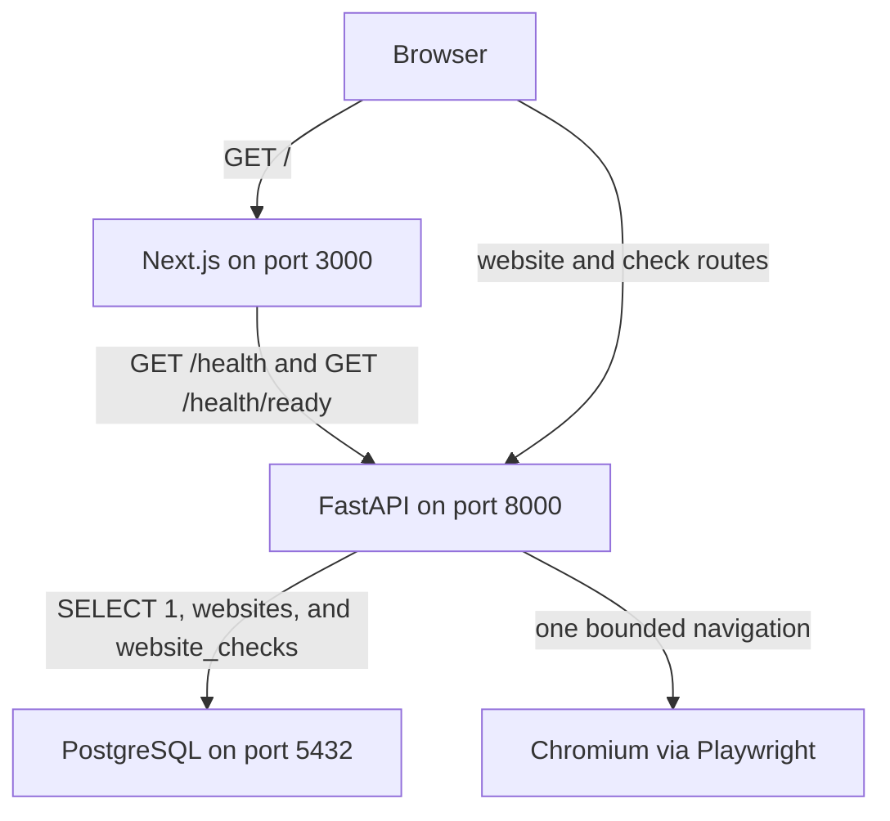
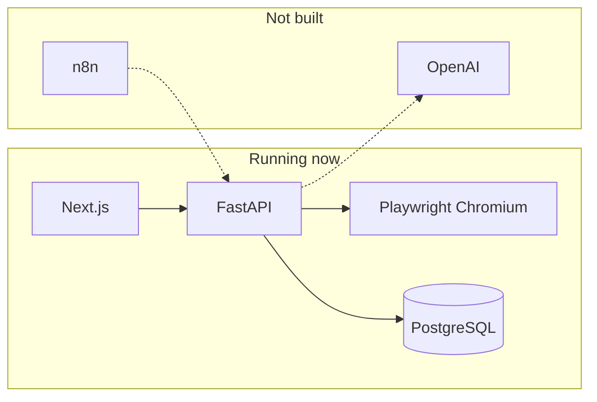
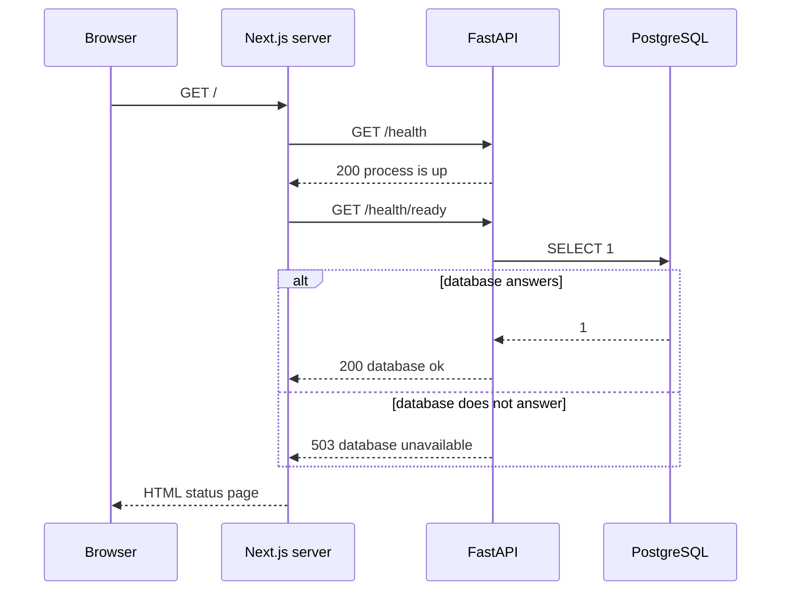
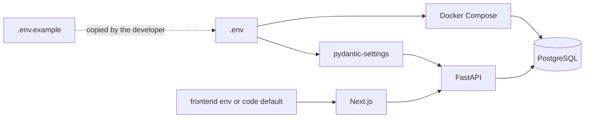
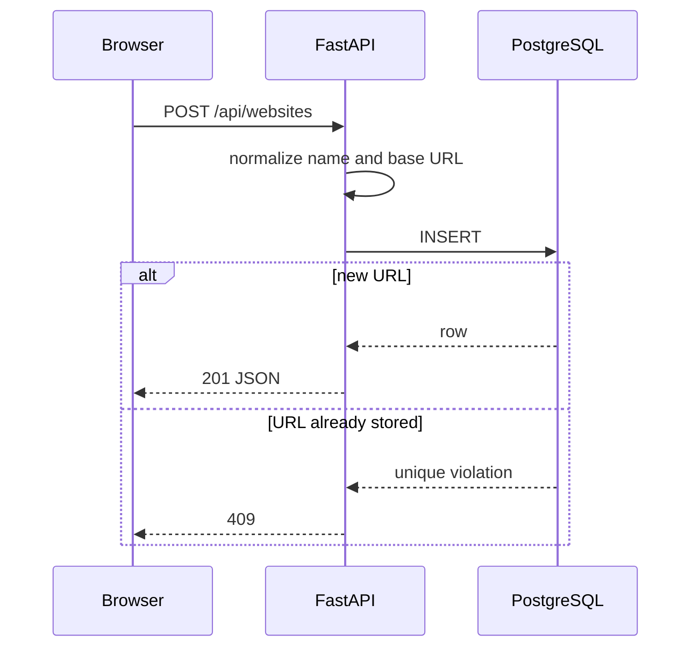
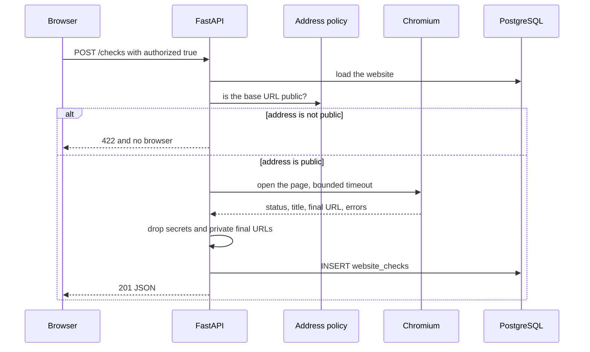

# Architecture overview

Sentinel is the start of a website testing and monitoring platform. A person will eventually describe a site to watch, the platform will open that site in a browser, and later steps will interpret the result and notify other tools.

Milestone 1 proved three things: the API can answer HTTP, it can open PostgreSQL, and the web app can render that report. Milestone 2 stores websites on that foundation. Milestone 3 opens one registered site in Chromium and stores the result. It still does not interpret a failure with a model, schedule a check, or notify another tool. There is one shared registry and no user accounts.

## How to read the repository

Start here, then read [the development environment guide](../learning/development-environment.md). That guide is the click-by-click setup and a file-by-file walk through one page load. This document is the map and the reasoning.

## Layout

```text
Sentinel/
├── README.md
├── .env.example
├── .gitignore
├── docker-compose.yml
├── docs/
│   ├── architecture/overview.md
│   └── learning/development-environment.md
├── backend/
│   ├── pyproject.toml
│   ├── alembic.ini
│   ├── alembic/
│   ├── app/
│   │   ├── main.py
│   │   ├── api/routes/health.py
│   │   ├── api/routes/websites.py
│   │   ├── api/routes/checks.py
│   │   ├── core/
│   │   │   ├── config.py
│   │   │   ├── database.py
│   │   │   └── urls.py
│   │   ├── models/website.py
│   │   ├── models/website_check.py
│   │   └── services/
│   │       ├── network.py
│   │       ├── browser.py
│   │       └── results.py
│   └── tests/
└── frontend/
    ├── package.json
    ├── package-lock.json
    ├── next.config.ts
    ├── tsconfig.json
    ├── next-env.d.ts
    ├── AGENTS.md
    ├── .env.example
    ├── app/
    │   ├── layout.tsx
    │   ├── page.tsx
    │   ├── websites/page.tsx
    │   └── globals.css
    ├── components/
    └── lib/
        ├── api.ts
        ├── websites.ts
        └── checks.ts
```

| Path | Purpose |
| --- | --- |
| `docker-compose.yml` | Starts PostgreSQL and nothing else. |
| `.env.example` | Documents the local database account and the API settings. Copy it to `.env` to override defaults. |
| `backend/app/main.py` | Builds the FastAPI application, CORS, logging, and the database lifecycle. |
| `backend/app/core/config.py` | Loads settings from the environment and the root `.env` file. |
| `backend/app/core/database.py` | Creates the async engine and session factory, and runs the connectivity query. |
| `backend/app/api/routes/health.py` | Liveness and readiness routes. |
| `backend/app/api/routes/websites.py` | Create, list, read, and delete registered websites. |
| `backend/app/api/routes/checks.py` | Run one check and read its history. |
| `backend/app/models/website.py` | The `websites` table. |
| `backend/app/models/website_check.py` | The `website_checks` table. Deleting a website deletes these rows. |
| `backend/app/services/network.py` | Rejects targets that are not public HTTP or HTTPS. |
| `backend/app/services/browser.py` | Launches Chromium, collects the result, and always closes it. |
| `backend/app/services/results.py` | Removes credential-shaped text before a result is stored. |
| `backend/alembic/` | Schema revisions. `0001_create_websites` creates the registry. `0002_create_website_checks` creates check history. |
| `backend/tests/` | Automated checks for configuration, health, URL rules, the registry, the address policy, and check persistence. |
| `frontend/app/page.tsx` | The status page. |
| `frontend/app/websites/page.tsx` | The website registry page. |
| `frontend/lib/api.ts` | Server-side fetch of `/health` and `/health/ready`. |
| `frontend/lib/websites.ts` | Browser calls to `/api/websites`, plus the form's input checks. |
| `frontend/lib/checks.ts` | Browser calls that run a check and load its history. |
| `docs/` | Explanations that should stay accurate as the code changes. |

`backend/.venv/` and `frontend/node_modules/` are created on your machine. They are not part of the design, and git ignores them.

## Runtime shape

The browser talks to Next.js. Next.js talks to FastAPI. FastAPI talks to PostgreSQL. Docker runs only the database. The API and the website run directly on the developer machine so code reload stays ordinary.



The next diagram is a boundary, not a second running system. Dotted arrows are seams we are leaving open. No code on those arrows exists yet.



Playwright drives Chromium against a site the caller says they may test. The OpenAI API will be used later to interpret results. n8n will sit outside this repository and call the API when a workflow needs Sentinel. The check stays inside the API request. A queue is a later decision, made when a check needs to leave that request.

## Request flow

Refreshing the home page does not make the browser call FastAPI. The Next.js server calls FastAPI while it is building the HTML. That keeps the first page free of client-side fetching while there is only one screen.



`/health` is liveness. It answers "is this process able to speak HTTP?" A supervisor can use a failed liveness check as a signal to restart the process.

`/health/ready` is readiness. It answers "can this process do useful work right now?" Today the only dependency is PostgreSQL. A database outage makes the API unready. It does not mean the Python process is dead, so it must not be treated as a reason to restart the process in a loop.

There is no supervisor in this milestone. The split is still the contract, because adding the check later would change every caller.

## Configuration flow

One root `.env` file feeds two different consumers. Docker Compose reads `POSTGRES_*` for the database container. The API reads `DATABASE_URL`, `ENVIRONMENT`, and `CORS_ORIGINS`. Unknown names are ignored by the API, which is why both groups can share the file.



`DATABASE_URL` is not generated from `POSTGRES_*`. Both have to be edited together. The example file keeps them on adjacent lines for that reason. The `+asyncpg` suffix is required. It tells SQLAlchemy which driver to load. A URL that starts with `postgresql://` would select a synchronous driver and then fail inside the async engine, so settings reject it at startup.

Next.js does not read the root `.env`. Its optional override is `frontend/.env.local`, documented by `frontend/.env.example`. Until that file exists, `frontend/lib/api.ts` uses `http://localhost:8000`.

## Components

### Browser

The browser is the developer's window onto the status page. In this milestone it does not hold application state and it does not call the API. Later product screens may call the API from the browser. CORS is already limited to the configured frontend origin so that step does not require opening the API to every site.

### Next.js application

`frontend/app/layout.tsx` is the HTML document: language, title, and the shared stylesheet.

`frontend/app/page.tsx` is a server component. `export const dynamic = "force-dynamic"` tells Next.js to render it on each request. Without that, a production build could try to snapshot the page at build time and would fail, or go stale, when the API was down during the build.

`frontend/lib/api.ts` fetches both health routes with an eight-second timeout and `cache: "no-store"`. Health is not a cacheable document. The module also checks the JSON shape before the page reads it, so an unexpected payload becomes an error message instead of a crash on a missing field. Eight seconds is longer than the database connect timeout on purpose: the page needs the `503` body so it can say the database is unavailable. If the page gave up at the same moment as the driver, a down database would look like a dead API.

`frontend/app/globals.css` is ordinary CSS. There is no component library and no styling framework. The page is a status display, and the stylesheet exists to make that display readable.

`frontend/next.config.ts` turns on React strict mode and pins the Turbopack root to the frontend directory, so a lockfile in a parent folder is not mistaken for this app. The dev server writes `frontend/AGENTS.md`. That file is Next.js's note to coding agents about this release. Sentinel's architecture stays in `docs/`.

### FastAPI application

`backend/app/main.py` exposes `create_app()` and a module-level `app`. Uvicorn loads `app.main:app`. Tests call `create_app()` so each test gets a new instance and a new engine. Startup creates the engine and the session factory and stores them on `app.state`. Shutdown calls `engine.dispose()` so the pool closes when the process stops.

CORS allows the origins in `CORS_ORIGINS` and rejects the idea of `*`. Credentials are allowed only because the origin list is explicit. Methods include the verbs later routes will need; the origin list is the actual restriction.

### Settings

`backend/app/core/config.py` uses `pydantic-settings`. The first call to `get_settings()` reads the environment and caches the result for the life of the process. Restart the API to pick up a changed `.env`.

The env-file path is computed from the location of `config.py`, not from the shell's current directory. `backend/app/core/config.py` is three directories below the repository root. That is a deliberate choice: `uvicorn` still works if a script starts it from another folder.

### SQLAlchemy and PostgreSQL

`backend/app/core/database.py` creates an async engine with `postgresql+asyncpg`. Importing the module does not connect. The pool connects on first use.

`pool_pre_ping=True` checks a pooled connection before handing it out. That matters in development, where the database container can restart while the API process keeps running.

`connect_args={"timeout": 2}` is passed to asyncpg. A readiness request fails in about two seconds when the database does not answer, rather than hanging. The status page waits longer than that, so it can render the `503`.

`database_is_reachable()` runs `SELECT 1`. Any exception becomes `False`. The exception text is not logged and is not returned to the client. asyncpg error text can contain the database URL, and the URL contains the password.

`create_session_factory()` builds the factory website routes use to open a transaction. `expire_on_commit=False` keeps loaded attributes usable after a commit. Async code cannot refresh them with an implicit lazy load, so a route that needs database-generated timestamps calls `session.refresh()` after `commit()`.

### Website registry

`Website` in `backend/app/models/website.py` is one of two mapped tables. The columns are `id` (UUID primary key), `name` (up to 120 characters), `base_url` (up to 2048 characters), `created_at`, and `updated_at`. `base_url` is unique. Database checks require a non-blank name and a base URL that starts with `http://` or `https://`.

`normalize_base_url()` in `backend/app/core/urls.py` is the application rule behind that column. It accepts only HTTP and HTTPS, rejects userinfo, queries, and fragments, lowercases the scheme and host, and drops a trailing slash and a default port. `https://Example.com:443/docs/` and `https://example.com/docs` are one site.

Alembic revision `0001_create_websites` creates the table. Run `alembic upgrade head` from `backend`. The API does not migrate on startup. If the table is missing, website routes return `503` with a schema message and do not include the driver error.

`POST /api/websites` returns `201` and the stored row. A second site with the same normalized URL returns `409`. `GET /api/websites` returns the rows newest first. `GET` and `DELETE` on `/api/websites/{website_id}` return `404` when the UUID is absent. An id that is not a UUID returns `422` before a query runs. Connection failures return `503` and the response does not contain the database URL.

There is no owner column. Every caller of this development process sees the same rows.



The page at `/websites` is a client component. It checks the form before sending, then calls the API with `fetch`. Loading, success, and error text are separate. Delete asks for confirmation in the row before it sends `DELETE`, and the confirmation says that check history will be deleted too.

### Website checks

`WebsiteCheck` stores one run: outcome (`success` or `failed`), HTTP status, page title, final URL, duration in milliseconds, console errors, failed-request summaries, a sanitized error message, and `created_at`. The foreign key uses `ON DELETE CASCADE`. `Website.checks` sets `passive_deletes`, so SQLAlchemy emits one `DELETE` for the website and PostgreSQL removes the history.

Registration and checking use different rules. `normalize_base_url()` accepts any HTTP or HTTPS host, including `localhost`, because the registry is a list. `ensure_public_http_url()` runs before Chromium starts. It allows only HTTP and HTTPS, rejects userinfo, and rejects a host that is local, private, loopback, link-local, reserved, multicast, or a known metadata name. Hostnames are resolved. If any returned address fails that test, the check is refused with `422`.

`PlaywrightCheckService.run()` then launches headless Chromium, routes every request through the same rule, and measures the navigation. A main-document status from 200 through 399 is `success`. A `4xx` or `5xx`, a timeout, or a navigation error is `failed`, and the row is still saved. The navigation timeout defaults to 15 seconds and must stay between 1 and 60. The service adds 10 seconds for the browser to start, then cancels the check. `page`, the browser context, the browser, and the Playwright driver are closed in a `finally` block.

The route waits for that result. Tests replace `app.state.check_runner` and, when they need DNS, `app.state.host_resolver`. The real service is built only when those are absent. Automated tests therefore do not visit public websites.

Stored text is passed through `sanitize_observation()`. URLs keep scheme, host, port, and path. Userinfo, queries, and fragments are dropped. Console lines and error text are truncated, and common `Authorization`, `Cookie`, `Bearer`, and userinfo-URL shapes are replaced. The response does not include request headers, cookies, or exception text.

These protections are not complete:

- Chromium connects after Sentinel's DNS lookup. A rebinding in that gap is not fully closed, and the per-check host cache makes the gap longer for later requests to the same host.
- WebSockets and some browser-internal requests may not pass through `page.route`.
- Odd address spellings that Python does not parse as an IP can still be treated as hostnames. Digit-only hosts and `0x` labels are rejected. Other encodings may remain.
- The page itself can print a secret in a shape the filter does not recognize.
- `authorized: true` is an acknowledgement. This process has no accounts, so it cannot prove ownership.

`POST /api/websites/{website_id}/checks` returns `201` with the stored row, including a failed navigation. `GET /api/websites/{website_id}/checks` returns the newest rows, default 20, maximum 50. `GET /api/checks/{check_id}` returns one row or `404`. An unknown website is `404`. An id that is not a UUID is `422`. A missing table is the same schema `503` as the registry.



The registry page asks for the acknowledgement before it sends that request. While the request is in flight the button reads `Checking…`. The result panel shows outcome, status, title, and duration. Console errors and failed requests render only when the row contains them. Check history is a second request, loaded when the row asks for it.

### Health routes

`GET /health` returns:

```json
{
  "status": "ok",
  "service": "sentinel-api",
  "version": "0.1.0",
  "environment": "development"
}
```

`GET /health/ready` adds `checks.database` with the value `ok` or `unavailable`. The HTTP status is `200` only when the check succeeded. Otherwise it is `503` and `status` is `degraded`. The body stays JSON in both cases so the page can explain the failure.

The route looks up the engine on `app.state`. If startup did not attach one, the check is treated as failed. A missing dependency is not a healthy service.

### Docker Compose

`docker-compose.yml` defines one service, `postgres`, from `postgres:16-alpine`. The major version is pinned so a later `docker compose pull` cannot silently move the database to another major version. The data directory is the named volume `sentinel_postgres_data`, which survives `docker compose down`. Removing the volume is what deletes local data.

The container healthcheck runs `pg_isready`. Compose's own interpolation uses `$`, so the file writes `$$POSTGRES_USER` to leave a single `$` for the shell inside the container.

The API is not containerized. Playwright, when it arrives, is the thing most likely to change that, because browser binaries are awkward to install on every developer machine. That is a later decision.

### Tests

Tests are part of the foundation, not a later cleanup.

- `test_config.py` rejects a database URL that would select the synchronous driver.
- `test_health.py` locks the liveness body, the CORS header for `http://localhost:3000`, and both readiness outcomes. The success and failure outcomes are forced with a monkeypatch so they do not depend on Docker. A further test points the engine at `127.0.0.1:1` with a distinctive password and requires the `503` body to contain neither the password nor the URL.
- `test_database.py` is marked `integration`. It runs `SELECT 1` against `DATABASE_URL`. If the driver cannot connect, the test skips and prints the exception type. That skip must not be reported as a passing database check.
- `test_urls.py` locks URL normalization and rejection without a database.
- `test_websites.py` applies the Alembic revision, then checks create, list, read, delete, duplicate URLs, missing rows, and a closed-port failure that must not echo the password. Persistence tests delete only the rows they insert.
- `test_network.py` locks the public-address rule. The resolver is a function the test supplies, so the suite does not call DNS.
- `test_check_service.py` locks the navigation budget, secret redaction, and the timeout setting. It does not launch Chromium.
- `test_checks.py` stores scripted results, refuses private targets without calling the runner, and checks that deleting a website deletes the history.

## Design decisions

**Monorepo.** The API, the web app, and the docs are one product and one checkout. Splitting repositories now would add version coordination before there is a second team.

**Async SQLAlchemy from the start.** FastAPI is an async framework. Playwright's Python API is async too. Starting with a synchronous engine would mean a rewrite of the database layer at the same time as the first browser feature. The cost of starting async is the `sqlalchemy[asyncio]` extra, which installs `greenlet`. Application code does not use greenlets directly. SQLAlchemy's async adaptation layer requires the library.

**asyncpg, not psycopg, in the URL.** asyncpg is the driver SQLAlchemy's async PostgreSQL dialect is most often paired with, and wheels for Python 3.14 were available when this milestone was installed. The URL scheme is validated so a sync URL cannot slip through.

**Host processes for the API and the web, Docker only for PostgreSQL.** Edit-and-reload is simpler when Uvicorn and Next.js are local processes. PostgreSQL is the stateful piece, so it is the piece Compose owns. Adding more containers before they earn their keep makes logs and networking harder to teach.

**No Redis and no Celery.** Saved websites and check results live in PostgreSQL. The API waits for one bounded check. A queue would still be an extra service. Background work can be reconsidered when a check needs to run outside the web request.

**Fail closed, and stay quiet about why.** Readiness returns `unavailable` for every connection failure: refused, timed out, wrong password, missing database. Website and check routes return `503` for those failures and do not include the driver text. A browser failure becomes a stored `failed` result with a fixed sentence. Callers do not need the driver or Playwright taxonomy. Operators can look at the API log, which records the exception class name and not the message.

**One shared registry.** Milestone 2 does not invent users to own each row. Authentication can be added when there is a real account model, instead of a placeholder user on every website.

**One settings cache.** Request handlers do not re-read the environment. That makes behavior stable for the life of the process and makes tests responsible for clearing `get_settings.cache_clear()` when they change an environment variable.

**Server-rendered status page.** The page is a view of the API, not a second implementation of health checks. When the API is down, the page says so. It does not invent an `ok` state.

## Dependencies

Declared directly, because each one is a choice. Versions below are the ones `pip` and `npm` installed for this milestone. `pyproject.toml` and `package.json` allow compatible newer releases within the stated floors.

### API runtime

| Package | Installed | Why it is here |
| --- | --- | --- |
| `fastapi` | 0.162.0 | HTTP routes, request validation, and the generated docs at `/docs`. |
| `uvicorn[standard]` | 0.54.0 | Process that serves the ASGI app. The `standard` extra adds reload and faster protocol implementations used by `--reload`. |
| `sqlalchemy[asyncio]` | 2.1.8 | Engine, connection pool, and `SELECT 1`. The `asyncio` extra adds `greenlet` 3.5.6. |
| `asyncpg` | 0.32.0 | PostgreSQL driver used by the async engine and by Alembic. |
| `pydantic-settings` | 2.16.2 | Reads environment variables and `.env` into a typed `Settings` object. |
| `alembic` | 1.20.1 | Schema revisions. It also installs Mako, which renders revision templates. |
| `playwright` | 1.64.1 | Python async API that launches Chromium. The browser binary is installed separately with `python -m playwright install chromium`. |

Playwright also installs `pyee` 14.0.0, which delivers browser events to the check service. The Chromium binary is not a pip package.

FastAPI also installed Starlette 1.10.0, Pydantic 2.14.3, and `python-dotenv` 1.2.4. Those are libraries our direct dependencies need. Application code imports FastAPI, Pydantic models, and `pydantic-settings`, not Starlette itself. OpenTelemetry's API package is pulled in by this FastAPI release. Sentinel does not configure tracing. It is not a product dependency.

### API tests

| Package | Installed | Why it is here |
| --- | --- | --- |
| `pytest` | 9.2.0 | Test runner. |
| `pytest-asyncio` | 1.4.1.post1 | Runs the `async` integration test. Fixture loop scope is set to `function` in `pyproject.toml`. |
| `httpx2` | 2.16.0 | HTTP library Starlette's `TestClient` imports. Current Starlette warns if the older `httpx` package is used instead. |

### Web

| Package | Installed | Why it is here |
| --- | --- | --- |
| `next` | 16.4.5 | React framework. App Router, server rendering, and the dev server. |
| `react`, `react-dom` | 19.3.1 | UI runtime. The status page is server-rendered. The registry is a client component. |
| `typescript` | 7.0.2 | Typecheck via `npm run typecheck`. |
| `@types/node` | 26.6.6 | Types for Node APIs such as `process.env`. |
| `@types/react`, `@types/react-dom` | 19.3.0 | Types for the page and layout. |

`package-lock.json` records the exact frontend tree npm installed.

### Not installed

The OpenAI SDK, an n8n deployment, Redis, and Celery. Alembic is installed because `websites` and `website_checks` need revisions. Chromium is installed with Playwright's own command, not with pip.

## Version identity

The API version string `0.1.0` lives in `backend/app/core/config.py` and is repeated as the package version in `backend/pyproject.toml`. The health payload reads the settings value. Update both when the milestone version changes.
