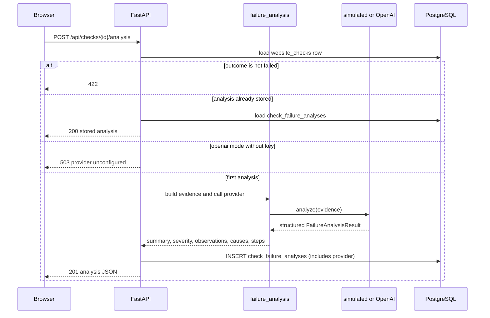
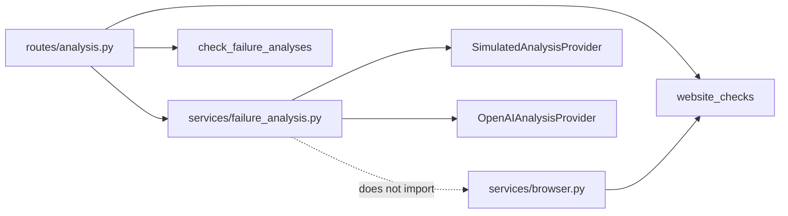

# AI failure analysis

This note explains on-demand analysis of a stored failed website check. Read it next to [the architecture overview](../architecture/overview.md) and the check walkthrough in [milestone-1-technical-walkthrough.md](milestone-1-technical-walkthrough.md).

## What it does

A person runs a browser check. When that check is stored as `failed`, the registry page can ask the API to analyze it. The API builds sanitized evidence from the stored row, runs the configured provider once, stores a structured result, and returns it. A second request for the same check returns the stored row and does not run the provider again.

**Development default:** `ANALYSIS_PROVIDER=simulated`. That path builds a deterministic analysis from the WebsiteCheck fields on this machine. It makes **zero** calls to OpenAI or any other AI API.

**Optional:** `ANALYSIS_PROVIDER=openai` with `OPENAI_API_KEY` uses the official OpenAI Python SDK. Keep this for a future paid integration; it is not required for local demos.

What it does **not** do:

- Start Chromium or run a new check
- Analyze successful checks
- Schedule analysis, queue work, or run agents/tools
- Send email, chat, or an n8n draft
- Require authentication or payments

## Request flow

`GET /api/checks/{id}/analysis` only reads. It never calls a provider.

## Boundaries inside the API

Routes own HTTP status codes and persistence. The analysis service owns provider selection, redaction, and the Pydantic shape. Playwright stays in `browser.py`.

## Structured result

The provider must return this shape:

| Field | Meaning |
| --- | --- |
| `summary` | Short description of what the evidence shows |
| `severity` | `low`, `medium`, `high`, or `critical` |
| `confirmed_observations` | Facts taken from the stored check |
| `possible_causes` | Hypotheses, each with `cause`, `confidence`, and `evidence` |
| `recommended_investigation_steps` | Concrete next checks for a developer |
| `limitations` | What the analysis cannot know from this evidence |
| `provider` | `simulated` or `openai` (stored and returned so clients cannot confuse them) |
| `model_name` | `simulated-local` or the OpenAI model id |

Confirmed observations are facts. Possible causes are hypotheses. Simulated results also put `SIMULATED ANALYSIS` in `limitations` and start the summary with `Simulated analysis…`. The UI shows a clear banner for simulated rows.

## Safety rules

1. Evidence is labeled untrusted before any OpenAI prompt.
2. Console text, titles, and error messages are passed through the same redaction helpers used for stored checks.
3. The OpenAI system prompt forbids following instructions found inside those fields.
4. Responses are validated again with Pydantic and redacted before storage.
5. Secrets must not appear in prompts or stored analysis fields. Redaction is a filter, not a guarantee.

## Configuration

| Variable | Purpose |
| --- | --- |
| `ANALYSIS_PROVIDER` | `simulated` (default) or `openai` |
| `OPENAI_API_KEY` | Required only when `ANALYSIS_PROVIDER=openai` |
| `OPENAI_MODEL` | Model id for OpenAI mode. Default `gpt-4o-mini` |
| `OPENAI_TIMEOUT_SECONDS` | Provider timeout, 1–120. Default `30` |
| `OPENAI_MAX_OUTPUT_TOKENS` | Output token cap, 100–4000. Default `1200` |

## Cost control and reuse

`check_failure_analyses.check_id` is unique. The first successful `POST` inserts a row. Later `POST`s return that row with HTTP `200` and do not run the provider again — simulated or OpenAI. There is no auto-analyze on check create and no scheduled analysis.

## How to try it on this machine

### Simulated (default)

1. Apply migrations: `.\.venv\Scripts\python.exe -m alembic upgrade head` from `backend`.
2. Leave `ANALYSIS_PROVIDER=simulated` (or omit it). No OpenAI key needed.
3. Restart the API, open `http://127.0.0.1:3000/websites`, run a check that fails, then **Analyze failure**.
4. Expect `provider: "simulated"`, model `simulated-local`, and a UI banner that says it is not a live model.

### OpenAI (optional)

1. Set `ANALYSIS_PROVIDER=openai` and `OPENAI_API_KEY=...` in the root `.env`.
2. Restart the API.
3. Analyze a failed check. Expect `provider: "openai"` and the configured model name.

Automated tests cover simulated defaults and prove the simulated path opens no external AI sockets.

## Related

Cross-check historical patterns for one site (repeated failures / latency spikes): **AI-2** — see [historical-pattern-hints.md](historical-pattern-hints.md).
