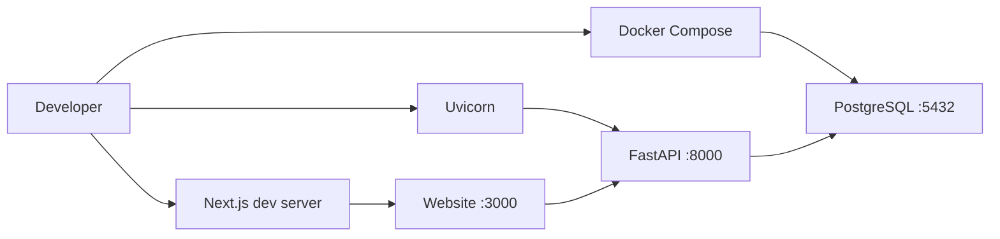

# Development environment

This guide explains the tools on your machine, how to start the milestone, and what each file does when you refresh the status page. The architecture and the reasons for it are in [the overview](../architecture/overview.md).

## The three processes

Sentinel in this milestone is three processes. They are not one program.



| Process | Where it runs | Address on Windows | What breaks if it is stopped |
| --- | --- | --- | --- |
| PostgreSQL | Docker Engine inside Ubuntu on WSL 2 | `localhost:5432` | Readiness returns `503`. The status page still loads. Liveness stays `200`. |
| Uvicorn serving FastAPI | Windows, `backend\.venv` | `http://127.0.0.1:8000` | The status page says the API could not be read. |
| Next.js | Windows, Node.js | `http://127.0.0.1:3000` | The browser has no page. The API is unaffected. |

Windows reaches the database through `wslrelay`, which forwards `localhost:5432` into the WSL container. PowerShell does not need a `docker` command for the API to connect.

## Tools and where they live

This checkout uses one split on purpose.

| Tool | Where | Version used here |
| --- | --- | --- |
| Python | Windows | 3.14.3 (`py -3.14`) |
| Project packages | `backend\.venv` only | See below |
| Node.js and npm | Windows | 22.19.0 and 10.9.3 |
| Git | Windows | Used for the repository |
| Docker Engine and Compose | Ubuntu on WSL 2 | Not a Windows program |
| PostgreSQL | Container `sentinel-postgres-1` | Image `postgres:16-alpine`, server 16.15 |

**Python stays in the virtual environment.** The Windows interpreter at `pythoncore-3.14-64` is only used to create `backend\.venv`. Project packages are not installed into it. `pytest` typed alone in PowerShell uses that system interpreter, so it fails with `No module named pytest`. That is the expected result. The working command is:

```powershell
cd backend
.\.venv\Scripts\python.exe -m pytest
```

**Python 3.14.** The installed wheels include native builds for 3.14: `asyncpg` 0.32.0, `greenlet` 3.5.6 (from `sqlalchemy[asyncio]`), and `pydantic-core` 2.50.4. `pip check` reports no broken requirements. The API, the live `SELECT 1`, and the test suite all ran on 3.14.3.

**Node.js** runs the Next.js app. There is no frontend test script. `npm run typecheck` is the check that exists.

**Docker** runs only inside Ubuntu. `docker` is not on the Windows `PATH`, and it should not be installed globally on Windows for this setup. The Ubuntu user has to be in the `docker` group. Membership is read at login, so a shell that was already open before the group change still gets `permission denied` on `/var/run/docker.sock`. Open a new Ubuntu terminal after that change.

## Create the local files

Open PowerShell in the repository root.

```powershell
Copy-Item .env.example .env
```

You can skip the copy while every value is still the example default. The API's built-in defaults match `.env.example`. Copy the file before you change a password, a port, or an origin. `.env` is gitignored. `.env.example` is the file other people read.

Backend, once:

```powershell
cd backend
py -3.14 -m venv .venv
.\.venv\Scripts\python.exe -m pip install -e ".[dev]"
```

The `-e` flag is an editable install. Python imports `app` from this checkout, so edits to `backend/app` are picked up without another install. Run the install again after you change `pyproject.toml`.

If activating the environment with `.\.venv\Scripts\Activate.ps1` is blocked by execution policy, keep calling `.\.venv\Scripts\python.exe` directly. Activation is a convenience. It is not required.

Frontend, once:

```powershell
cd frontend
npm install
```

## Start PostgreSQL

Open Ubuntu, not PowerShell. Change into this repository. A Windows folder such as `C:\Users\<you>\Desktop\Sentinel` is `/mnt/c/Users/<you>/Desktop/Sentinel` inside WSL.

```bash
cd /mnt/c/Users/<you>/Desktop/Sentinel
docker compose up -d
docker compose ps
```

`ps` should show `sentinel-postgres-1` as healthy. The healthcheck runs `pg_isready`. The published port is `5432` on both the WSL network and Windows `localhost`.

From PowerShell you can see the forward without a Docker client:

```powershell
netstat -ano | findstr ":5432"
```

The listening process is `wslrelay.exe`. If that line is missing, the container is not published to Windows, and the API cannot reach it at `localhost`.

Stop the container from Ubuntu:

```bash
docker compose stop
```

`docker compose down` removes the container and keeps the named volume. `docker compose down -v` deletes that volume too. Do not use `-v` unless you mean to throw away the local database. Leave the container running while you use the API.

The default user, password, and database name are all `sentinel`. That password is for a database bound to your machine. It is not a secret to reuse anywhere else.

## Start the API

From `backend`, apply the schema and then start the API:

```powershell
.\.venv\Scripts\python.exe -m alembic upgrade head
.\.venv\Scripts\python.exe -m uvicorn app.main:app --reload --host 127.0.0.1 --port 8000
```

`alembic upgrade head` creates `websites` and `website_checks` when they are missing. The API does not run migrations on startup. Without those tables, website and check routes return `503` and tell you the schema is not ready. `/health` still returns `200`.

Install Chromium in this virtual environment before you run a check yourself. The Python package does not include the browser.

```powershell
.\.venv\Scripts\python.exe -m playwright install chromium
```

Pytest does not need that browser. A check you start from the registry page does.

`--reload` restarts the process when a Python file changes. Settings are read at startup, so a change to `.env` is picked up on the next reload.

Check liveness:

```powershell
Invoke-RestMethod http://127.0.0.1:8000/health
```

Check readiness:

```powershell
try {
  Invoke-RestMethod http://127.0.0.1:8000/health/ready
} catch {
  $_.Exception.Response.StatusCode
  $_.ErrorDetails.Message
}
```

PowerShell throws on a `503`. That throw is the readiness failure, not a broken command. The message body still says whether the database was unavailable.

Open `http://127.0.0.1:8000/docs` for the generated reference. FastAPI builds that page from the route declarations. You do not write it by hand.

## Start the website

From `frontend`:

```powershell
npm run dev
```

Open `http://127.0.0.1:3000`.

When both processes are up and PostgreSQL answered, the page shows the API process as `ok (200)` and the database as `ok (200)`. When the API is up and PostgreSQL is not, the database row is `unavailable (503)` and the page tells you to start Docker Compose. When the API is not running, the page says it could not be read and shows the address it tried.

To point the page at an API that is not on port 8000, create `frontend/.env.local`:

```text
NEXT_PUBLIC_API_URL=http://127.0.0.1:8000
```

Restart `npm run dev` after changing that file. Next.js reads frontend env files only from `frontend/`. A variable in the root `.env` does not reach the website.

The first `npm run dev` may adjust `frontend/tsconfig.json`. This Next.js version requires `jsx` set to `react-jsx` and adds its generated type folders to `include`. Those edits are already in the repository. `frontend/next.config.ts` sets `turbopack.root` to the frontend directory so the dev server does not walk upward and treat a `package-lock.json` in a parent folder as the project. Next.js also writes `frontend/AGENTS.md` when the dev server starts. That file is a note about this Next.js release for coding agents. Sentinel's own architecture stays in `docs/`.

`NEXT_PUBLIC_` means the value is allowed to appear in browser code. The status page reads it on the server. The website registry and its check actions read it in the browser. The API address is not a secret.

## Run a website check

Chromium has to be installed in the backend virtual environment, and `alembic upgrade head` has to have applied `0002_create_website_checks`. The API and the website are both running.

1. Open `http://127.0.0.1:3000/websites`.
2. Register a site you are allowed to test. `http://127.0.0.1:3000` can be registered, and it is the right negative example: Run check returns an error and does not open it.
3. On a public site you may test, choose Run check.
4. Read the notice, tick "I am authorized to test this website", and choose Run check again.
5. The button reads `Checking…` until the API returns. A default check can take about 15 seconds, plus a few seconds for Chromium to start. The page waits up to 40 seconds.
6. The row shows Success or Failed, the HTTP status, the title, and the duration. Console errors and failed requests are listed when the result has them.
7. Check history loads the stored rows. Deleting the website asks you to confirm, then deletes those rows too.

The same request from PowerShell, after you copy a website id from the page or from `GET /api/websites`:

```powershell
Invoke-RestMethod http://127.0.0.1:8000/api/websites/<website-id>/checks -Method Post -ContentType "application/json" -Body '{"authorized":true}'
```

`GET http://127.0.0.1:8000/api/websites/<website-id>/checks` returns the newest checks. Add `?limit=5` to take fewer than the default of 20.

## What happens when you refresh the page

Follow this once with the files open.

1. The browser requests `/` from Next.js.
2. `frontend/app/page.tsx` calls `getApiSnapshot()` in `frontend/lib/api.ts`. The page is a server component, so this function runs in the Next.js process.
3. `resolveApiUrl()` reads `NEXT_PUBLIC_API_URL` or uses `http://localhost:8000`.
4. `fetch` calls `GET /health`, then `GET /health/ready`, each with an eight-second limit. `cache: "no-store"` prevents Next.js from reusing an old health document. The limit is longer than the API's two-second database connect timeout so a refused database still produces a `503` the page can show.
5. The browser's cross-origin rules are not involved in this hop. The caller is the Next.js server. CORS matters on `/websites`, where the browser calls the API directly. That header is tested.
6. Uvicorn hands the request to the FastAPI app built in `backend/app/main.py`.
7. `GET /health` in `backend/app/api/routes/health.py` returns the process identity. It does not ask for a database connection.
8. `GET /health/ready` takes the engine from `app.state` and calls `database_is_reachable()` in `backend/app/core/database.py`.
9. That function opens a connection from the pool and executes `SELECT 1`. The URL came from `get_settings()` in `backend/app/core/config.py`, which read the root `.env` or the built-in default.
10. asyncpg talks to PostgreSQL on port `5432`.
11. The route turns the boolean into JSON and a status code. Failures become `503` with `checks.database` set to `unavailable`.
12. `api.ts` checks that both payloads have the fields the page uses.
13. `page.tsx` renders the definition list. Next.js sends HTML to the browser.

If step 10 cannot connect, steps 11 through 13 still happen. The page is supposed to render the failure.

## Tests

From `backend`, with the project virtual environment. Do not use the system `pytest` command.

```powershell
.\.venv\Scripts\python.exe -m pytest -v
```

From `frontend`:

```powershell
npm run typecheck
```

`typecheck` runs `tsc --noEmit`. It does not prove the page looks right. It proves the TypeScript still agrees with itself.

Pytest is configured in `backend/pyproject.toml`:

- `pythonpath = ["."]` so `import app` works when the current directory is `backend`.
- `asyncio_mode = "auto"` so the integration test can be a plain `async def`.
- `asyncio_default_fixture_loop_scope = "function"` so pytest-asyncio does not warn about an unset default. The suite does not define async fixtures. The setting matches the scope the plugin is moving to.

What the tests are allowed to claim:

| Test | Proves | Does not prove |
| --- | --- | --- |
| Liveness | The app returns the expected JSON with status `200`. | That PostgreSQL is installed. |
| Startup | The engine and session factory exist after startup. | That a query succeeded. |
| CORS | `Origin: http://localhost:3000` is echoed back. | That a browser was opened. |
| Readiness monkeypatches | The route maps `True` to `200` and `False` to `503`. | That the driver works. |
| Closed port `127.0.0.1:1` | A real driver failure becomes `503` and the password stays out of the body. | That your `DATABASE_URL` is correct. |
| `integration` test | `SELECT 1` against the configured database, when the connection succeeds. | Anything, when the test is skipped. |

When PostgreSQL is not reachable, `tests/test_database.py` calls `pytest.skip` and includes the exception class name. Expect the suite to pause for about the connect timeout, which is two seconds, on that test. Read the skip line. Do not count it as a database pass.

Run the live check on its own after the container is healthy:

```powershell
.\.venv\Scripts\python.exe -m pytest -m integration -v
```

With `sentinel-postgres-1` healthy and `DATABASE_URL` pointed at `localhost:5432`, this test passes. It skips only when the driver cannot connect. A skip is not a pass. `-rs` prints the skip reason if that happens.

## Where settings come from

`get_settings()` looks in this order:

1. The process environment. A variable you set in PowerShell wins.
2. The root `.env` file, if it exists.
3. The defaults written on the `Settings` class.

The file path is `Path(__file__).resolve().parents[3] / ".env"` inside `config.py`. Counting upward: `core`, `app`, `backend`, repository root. The shell's current directory is not used. That is why starting Uvicorn from `backend` still finds the root file.

`extra="ignore"` is set so `POSTGRES_PASSWORD` in the same file does not crash the API. Compose and the API share the file and ignore each other's names.

Two values must still match even though they are different names. `POSTGRES_USER`, `POSTGRES_PASSWORD`, `POSTGRES_DB`, and the host port have to agree with the user, password, database, and port inside `DATABASE_URL`. Compose does not build the SQLAlchemy URL for you.

A URL that does not start with `postgresql+asyncpg://` fails validation. The usual mistake is copying a URL from a synchronous tutorial (`postgresql://...` or `postgresql+psycopg2://...`).

After a settings change, restart Uvicorn. The settings object is cached. Tests that set an environment variable call `get_settings.cache_clear()` so they do not leak into the next test.

## Logs

Uvicorn prints request lines. The application logger uses `%(asctime)s %(levelname)s %(name)s %(message)s`.

A failed readiness check logs the exception class only, for example `TimeoutError` or `ConnectionRefusedError`. It does not log the driver message. That message can include the database URL. Use the class name as the clue, then check Compose and `DATABASE_URL`.

## Failures you are likely to see

**`pytest` is not recognized, or Python says `No module named pytest`.** The shell used Windows Python. Run `.\.venv\Scripts\python.exe -m pytest` from `backend`. Do not `pip install` into the system interpreter.

**`Invoke-RestMethod http://127.0.0.1:8000/health/ready` cannot connect.** Uvicorn is not running. Start it with the virtual environment, as shown above. A connection error is different from a `503`.

**`docker` is not recognized in PowerShell.** That command belongs in Ubuntu. The API still uses `localhost:5432`.

**`permission denied` on `/var/run/docker.sock`.** The Ubuntu user is not in the `docker` group, or the shell was opened before the group was added. Open a new Ubuntu terminal. Do not restart WSL just to refresh the group while you still need the database: `wsl --shutdown` stops the container.

**Readiness is `503` and the page is otherwise fine.** The API is doing what it should. In Ubuntu, check `docker compose ps`. Then check that `DATABASE_URL` uses host `localhost`, port `5432`, and the same user, password, and database as `POSTGRES_*`.

**The page says the API could not be read.** Next.js could not complete the fetch within eight seconds. Start Uvicorn, or fix `NEXT_PUBLIC_API_URL`. A database outage should not look like this. It should show `unavailable (503)`.

**`DATABASE_URL must start with postgresql+asyncpg://`.** The driver prefix is missing. The async engine will not guess one.

**Port `8000` or `3000` is already in use.** Stop the other process or pass a different port. If you move the API, update the frontend URL. If you move the website, add that origin to `CORS_ORIGINS` before any browser code calls the API.

**Activate.ps1 cannot be loaded.** Call `.\.venv\Scripts\python.exe` as the examples do.

**The check says the browser runner is not available.** The Playwright package is installed, but Chromium is not. From `backend`, run `.\.venv\Scripts\python.exe -m playwright install chromium` and try the check again.

**The check says the address is not a public HTTP or HTTPS site.** That is the address policy. Localhost, private networks, and cloud metadata addresses are refused before Chromium starts. Register a public site you are allowed to test.

**Checking… ends with a timeout message.** The navigation exceeded `CHECK_NAVIGATION_TIMEOUT_SECONDS`, or the page stopped waiting at 40 seconds. The API may still store a failed row. Open Check history.

**Pytest seems to hang for a few seconds near the end.** That is the integration test waiting on the two-second connect timeout. Let it finish and read whether the test passed or skipped. The check tests do not add a browser download or a public-site visit.

## What this environment is not

It is not a production deploy. Reload, the default password, and a database published on `localhost` are for learning and local work.

It is not a monitoring service. A check runs once, when you ask, inside the API process. Nothing repeats it, and nothing calls an AI model. There is no account. The authorization checkbox records that you said you may test the site. It does not prove that you may.
