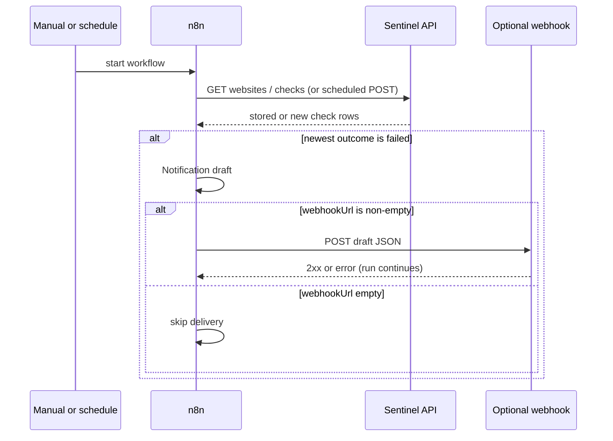

# Failure draft delivery

This note explains how Sentinel can **deliver** a failed-check notification draft through n8n. It builds on [n8n follow-up](n8n-follow-up.md) and [scheduled monitoring](scheduled-monitoring.md).

## The idea

A failed check produces a small JSON draft in n8n (`website_name`, `base_url`, `outcome`, `http_status`, `error_message`, `checked_at`, plus a human `text` line). Delivery is an optional **HTTP POST** of that JSON to a URL you choose.

That URL can be:

- [webhook.site](https://webhook.site) for a free catch-all while learning
- A Slack **Incoming Webhook** (reads the `text` field)
- A Discord webhook (may prefer `content`; reshape in n8n if needed)
- Any other HTTPS endpoint that accepts JSON

Sentinel does not send email itself and does not require a paid mail provider. For a **local SMTP inbox** (Mailpit via Compose profile `mail` + optional n8n Email node), see [free email path](free-email-path.md) (AUTO-3).

## Safe defaults

| Control | Default |
| --- | --- |
| Workflow `active` | `false` (import stays inactive) |
| `webhookUrl` in **API address** | empty string |
| Missing destination | **Webhook configured** false branch — no POST |
| Delivery HTTP error | **Deliver draft** continues (`onError: continueRegularOutput`); Sentinel API is untouched |

Nothing is delivered until you set `webhookUrl` **and** run (or activate) the workflow.

## Flow

## Where it lives

| File | Delivery path |
| --- | --- |
| `n8n/workflows/failed-check-follow-up.json` | After reading the newest stored check |
| `n8n/workflows/scheduled-website-checks.json` | After monitoring-state AUTO-2 intents (`should_notify_*`) |

Both use the same gate: **Webhook configured** → **Deliver draft**.

## Configuration

1. Copy a destination URL into the workflow **API address** node field `webhookUrl`.
2. Optionally record the same value in root `.env` as `FAILURE_DRAFT_WEBHOOK_URL=` for documentation only — n8n does not load that variable (same reason as `SENTINEL_API_URL`).
3. Keep the workflow inactive until you want it to run.
4. Execute manually once to verify the webhook receives JSON.

### Slack Incoming Webhook

Create an Incoming Webhook in Slack. Paste the URL into `webhookUrl`. The draft includes `text`, which Slack displays.

### Discord

Discord webhooks often expect `{ "content": "..." }`. Either:

- Add a Set node that maps `text` → `content` before **Deliver draft**, or
- Point at a generic catcher first (webhook.site) while learning.

## What Sentinel does not do

- Store the webhook URL in Postgres
- Deliver from FastAPI or the Next.js app
- Require Gmail / SES / paid SMTP
- Auto-deliver on every Playwright check from the registry UI

The registry page only hints that n8n can deliver drafts when a webhook is configured.

## Demo checklist

1. Open webhook.site and copy your unique URL.
2. In n8n, edit **API address** → set `webhookUrl` to that URL.
3. Ensure at least one website has a newest check with `outcome=failed` (or enroll + run scheduled path).
4. Execute **Sentinel failed-check follow-up** once.
5. Confirm webhook.site shows a POST body with the draft fields.
6. Clear `webhookUrl` again when you want local-only drafts.
