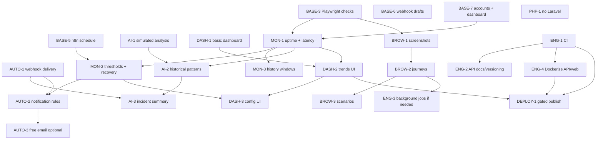

# Sentinel advanced roadmap

Finite plan for the learning/portfolio product on this machine. No paid hosting, paid AI, or public-deploy claims until the gated checklist is done and the user approves hosting.

**Branch context (dirty WIP, not committed):** registry, Playwright checks + SSRF guards, accounts/sessions, basic dashboard, on-demand AI analysis (`simulated` default), n8n scheduled monitoring, failure-draft webhook delivery.

Status key: **done** · **partial** · **not started** · **gated**

---

## Already on the branch (baseline)

| Id | Name | Status | Notes |
| --- | --- | --- | --- |
| BASE-1 | API health + Postgres + Next status page | done | Milestone 1 |
| BASE-2 | Website registry CRUD | done | Ownership via accounts |
| BASE-3 | Bounded Playwright check + history | done | Public-URL / SSRF policy |
| BASE-4 | On-demand AI failure analysis | done | `ANALYSIS_PROVIDER=simulated` default; OpenAI optional |
| BASE-5 | n8n scheduled monitoring | done | Opt-in `monitoring_enabled` + schedule token |
| BASE-6 | Failure draft → optional webhook | done | n8n delivery when `webhookUrl` set |
| BASE-7 | Email/password accounts + basic dashboard | done | Cookie sessions; automation token for n8n |

---

## Milestones

### 1. Advanced monitoring

#### MON-1 — Uptime & latency trends
| | |
| --- | --- |
| **Depends on** | BASE-3, BASE-7 |
| **Status** | **done** |
| **Complexity** | M |
| **Acceptance** | Authenticated `GET` summary per website (and dashboard roll-up): success rate / uptime over a window, count of checks, avg + p95 `duration_ms`, ordered recent `(created_at, outcome, duration_ms)` points. UI shows these without a paid chart SaaS. Tests + learning note. Playwright/n8n/AI paths unchanged. |

#### MON-2 — Thresholds & recovery
| | |
| --- | --- |
| **Depends on** | MON-1, BASE-5 |
| **Status** | **done** |
| **Complexity** | M |
| **Acceptance** | Per-site optional latency/failure thresholds; detect failure→success recovery in recent history; expose state on API; n8n can branch on “recovered” vs “still failing” without inventing Redis. Docs + tests. |

#### MON-3 — Richer check history windows
| | |
| --- | --- |
| **Depends on** | MON-1 |
| **Status** | **done** |
| **Complexity** | S |
| **Acceptance** | Documented window query (e.g. last 24h / 7d) with caps; no unbounded scans; dashboard uses it. |

---

### 2. Advanced browser automation

#### BROW-1 — Screenshots on check
| | |
| --- | --- |
| **Depends on** | BASE-3 |
| **Status** | **done** |
| **Complexity** | M |
| **Acceptance** | Optional screenshot artifact for a check (local storage path or DB reference); shown on check detail; size/timeout bounded; tests with fake runner. |

#### BROW-2 — Multi-step journeys / forms
| | |
| --- | --- |
| **Depends on** | BROW-1 |
| **Status** | **done** |
| **Complexity** | L |
| **Acceptance** | Declarative mini-journey (navigate → optional fill/click → assert); stored separately from one-shot URL checks; SSRF still enforced; learning doc. |

#### BROW-3 — Scenario library
| | |
| --- | --- |
| **Depends on** | BROW-2 |
| **Status** | **done** |
| **Complexity** | M |
| **Acceptance** | Named reusable scenarios attached to a website; run on demand; schedule enrollment optional later. |

---

### 3. AI

#### AI-1 — Simulated + optional OpenAI analysis
| | |
| --- | --- |
| **Depends on** | BASE-3 |
| **Status** | **done** |
| **Complexity** | M |
| **Acceptance** | Met: on-demand analysis, simulated default, OpenAI optional, no auto-call on every failure. |

#### AI-2 — Historical pattern hints
| | |
| --- | --- |
| **Depends on** | AI-1, MON-1 |
| **Status** | **done** |
| **Complexity** | M |
| **Acceptance** | Simulated (default) summary of repeated failures / latency spikes across recent checks for one site; optional OpenAI path; never required for demos. |

#### AI-3 — Incident summary draft
| | |
| --- | --- |
| **Depends on** | AI-2, AUTO-1 |
| **Status** | **done** |
| **Complexity** | M |
| **Acceptance** | One-click or n8n-triggered incident paragraph from last N failed checks + analyses; webhook-friendly JSON; simulated default. |

---

### 4. Automation / notifications

#### AUTO-1 — Webhook draft delivery
| | |
| --- | --- |
| **Depends on** | BASE-5 |
| **Status** | **done** |
| **Complexity** | S |
| **Acceptance** | Met: optional free webhook from n8n when `webhookUrl` set. |

#### AUTO-2 — Notification rules
| | |
| --- | --- |
| **Depends on** | MON-2, AUTO-1 |
| **Status** | **done** |
| **Complexity** | M |
| **Acceptance** | Simple rules (on fail / on recover / latency over threshold) stored in Sentinel or n8n Set nodes; documented; no paid email required for MVP (webhook.site / Discord / Slack Incoming Webhook OK). |

#### AUTO-3 — Free email path (optional)
| | |
| --- | --- |
| **Depends on** | AUTO-2 |
| **Status** | **done** |
| **Complexity** | S |
| **Acceptance** | Met: optional Compose profile `mail` runs free Mailpit; docs cover n8n Email → SMTP (`mailpit:1025`) plus existing free webhooks. No paid ESP. Stock workflow JSON stays without `emailsend`. |

---

### 5. Dashboard / reporting

#### DASH-1 — Basic signed-in dashboard
| | |
| --- | --- |
| **Depends on** | BASE-7 |
| **Status** | **done** |
| **Complexity** | S |
| **Acceptance** | Met: sites + recent checks. |

#### DASH-2 — Health + trends UI
| | |
| --- | --- |
| **Depends on** | MON-1, DASH-1 |
| **Status** | **done** |
| **Complexity** | M |
| **Acceptance** | Dashboard shows uptime/latency from MON-1; per-site drill-down; check detail links analysis (and screenshots when BROW-1 exists). No chart SaaS. |

#### DASH-3 — Config surface
| | |
| --- | --- |
| **Depends on** | DASH-2, MON-2 |
| **Status** | **done** |
| **Complexity** | S |
| **Acceptance** | Met: consolidated **Monitoring configuration** (enrollment + thresholds + notification rules) on `/websites` and `/websites/[id]`; copy stays honest that n8n owns the timer. |

---

### 6. Engineering / security

#### ENG-1 — Tests, validation, SSRF, auth
| | |
| --- | --- |
| **Depends on** | — |
| **Status** | **done** |
| **Complexity** | M |
| **Acceptance** | Met: local pytest covers auth/SSRF/validation; `.github/workflows/ci.yml` runs pytest (Postgres service) + frontend typecheck/build on push/PR; disposable CI env; no secret/env dumps in the workflow. |

#### ENG-2 — API docs / light versioning
| | |
| --- | --- |
| **Depends on** | ENG-1 |
| **Status** | **done** |
| **Complexity** | S |
| **Acceptance** | Met: stability expectations in `docs/learning/api-stability.md`; OpenAPI at `/docs`; **no** `/api/v1` churn until a breaking change forces it. |

#### ENG-3 — Background longer checks (only if justified)
| | |
| --- | --- |
| **Depends on** | BROW-2 |
| **Status** | **done (skipped — not needed)** |
| **Complexity** | L |
| **Acceptance** | Met by decision: request-bound `JOURNEY_BUDGET_SECONDS` still sufficient; no Redis/Celery; retries = re-POST. See store `docs/eng-3-decision.md`. |

#### ENG-4 — Dockerize API + web (compose extend)
| | |
| --- | --- |
| **Depends on** | ENG-1 |
| **Status** | **done** |
| **Complexity** | M |
| **Acceptance** | Met: `backend/Dockerfile` + `frontend/Dockerfile`; Compose profile `app`; named volumes preserved; demo path in `docs/learning/docker-demo.md`. |

---

### 7. PHP / Laravel assessment

#### PHP-1 — Decision record (no duplicate API)
| | |
| --- | --- |
| **Depends on** | — |
| **Status** | **done (decision below)** |
| **Complexity** | S |
| **Acceptance** | Written decision: do **not** add a Laravel app that reimplements Sentinel’s API, checks, or auth. |

**Decision:** Keep **FastAPI + Next.js + n8n + Postgres**. FastAPI already owns async IO, Playwright orchestration, Alembic, and OpenAPI. Next.js owns the UI. n8n owns timers and notification fan-out. A Laravel service would only be justified for an unrelated PHP-only surface (e.g. a separate marketing site the portfolio already requires)—not for monitoring. Duplicating models/routes in Laravel would split the source of truth and the learning story. **No Laravel service in this roadmap.**

---

### 8. Final deployment / publication (gated)

#### DEPLOY-1 — Portfolio publish checklist
| | |
| --- | --- |
| **Depends on** | DASH-2, ENG-1, ENG-4, AUTO-2 (soft), user **approval for hosting** |
| **Status** | **prep done — awaiting user accounts / DNS / approval** (not deployed) |
| **Complexity** | L |
| **Acceptance** | Integration + security review notes; full tests green; Docker path; choose free-tier host **only after user approval**; demo script; README portfolio section; no secrets in git; external browser verify of the public URL. **Do not claim public deploy until this row is done.** |

**Hosting:** Assessment `render-neon-compatibility.md` (**no-go** public Playwright on Render Free). **Public-shell prep** implemented (`PUBLIC_SHELL`, demo labels, Neon SSL/timeouts, closed registration) — see `docs/learning/public-shell-deploy.md` and store `docs/public-shell-prep-completion.md`. Still needs user Neon/Render accounts, DNS, and approval before go-live.

---

## Dependency graph

---

## Build order (suggested)

1. ~~MON-1~~ **done**  
2. ~~MON-2~~ **done**  
3. ~~DASH-2~~ **done**; ~~AUTO-2~~ **done**; ~~MON-3~~ **done**; ~~DASH-3~~ **done**; ~~AUTO-3~~ **done**; ~~ENG-1~~ **done**  

4. ~~BROW-1~~ **done**; ~~BROW-2~~ **done**; ~~BROW-3~~ **done**  
5. ~~AI-2~~ **done**; ~~AI-3~~ **done**  
6. ~~ENG-1~~ **done**; ~~ENG-2~~ **done**; ~~ENG-3~~ **done (skipped)**; ~~ENG-4~~ **done**  
7. DEPLOY-1 only after user approves hosting (not started)  

---

## Explicit roll-up

| Area | Already done | Partially done | Not started |
| --- | --- | --- | --- |
| Monitoring | n8n schedule, opt-in, **uptime/latency (MON-1)**, **thresholds/recovery (MON-2)**, **history windows (MON-3)** | — | — |
| Browser | one-shot Playwright check, **screenshots (BROW-1)**, **journeys (BROW-2)**, **scenario library (BROW-3)** | — | — |
| AI | simulated + optional OpenAI on-demand, **pattern hints (AI-2)**, **incident drafts (AI-3)** | — | — |
| Automation | webhook draft delivery, **notification rules (AUTO-2)**, **Mailpit free email path (AUTO-3)** | — | — |
| Dashboard | basic sites + recent checks, **health/trends (DASH-2)**, **config surface (DASH-3)** | — | — |
| Engineering | pytest, SSRF, auth, OpenAPI, **CI (ENG-1)**, **API stability docs (ENG-2)**, **no queue (ENG-3)**, **API/web Dockerfiles (ENG-4)** | Compose DB/n8n (+ optional Mailpit/app) | — |
| PHP/Laravel | decision: do not add | — | — |
| Deploy | — | — | gated checklist |

---

*Living document for this portfolio build. Update status rows when a milestone completion doc lands under the agent store `docs/`.*
